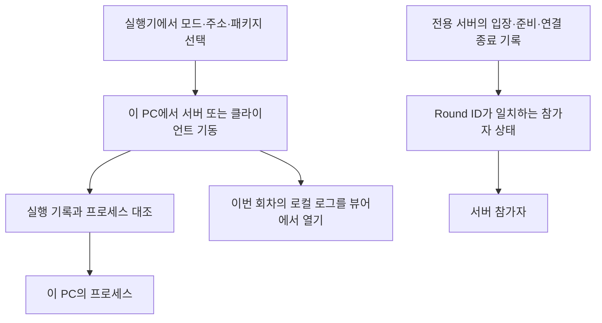

# 검증 실행기 제작 사례

CoopRPG · 2026-11-19 정리 · `c0fed32` 별도 PC 기준선과 `feat/validation-launcher` 후속 작업

반복 시험에서 어느 서버가 살아 있고 누가 접속했는지 한 창에서 확인하기 위해 검증 실행기를 만들었다. 사용자는 기존 서버 재사용을 알아차리고, 로컬 프로세스와 서버가 관측한 참가자를 구분하는 방식을 제안했다. 실제 창을 보며 설정 행과 정보의 정렬 기준도 여러 차례 조정했다.

**색인** · [문제와 계획](#problem) · [구조](#architecture) · [사용자 검토와 보완](#review) · [접속·종료 트러블슈팅](#client-lifecycle-troubleshooting) · [검증과 남은 범위](#verification)

## 문제와 계획

데스크톱과 노트북으로 첫 판을 끝낸 뒤 사용자가 게임 창을 다시 열었을 때 스테이지 2로 접속했다. AI가 원본을 대조하자 첫 완주 직후 만들어진 Round ID와 재접속 로그의 Round ID가 같았다. 전용 서버는 별도 프로세스로 남아 있었고, 사용자는 실제로 서버를 조회하고 종료한 뒤 다시 확인했다.

사용자는 반복 기동 명령과 프로세스 조회를 줄이고, **별도 창에서 서버·클라이언트 시작, 상태 확인, 종료와 실패 이유**를 함께 보고 싶다고 제안했다. 첫 범위는 `로컬 2인`, `Tailscale 호스트`, `접속 전용`으로 나눴다. AI는 기존 기동 스크립트를 재사용하고 프로세스 복원·게임 입장·오류 표시를 연결했다. 이어 두 PC에서 호스트가 알 수 있는 참가자 상태를 추가하고, 패키지 선택과 창 배치를 다듬었다.

**근거** · [스테이지 2 재접속 원인](../Validation/LanBaseline.md#stage2-server-reuse) · [실행기 범위와 완료 기준](../Roadmap.md#validation-launcher) · [AI 협업 근거 색인](../Portfolio/AICollaborationEvidence.md#launcher-case)

## 프로세스와 참가자 상태의 출처

로컬 프로세스의 PID·시작 시각·실행 파일 경로를 대조해 실행기를 다시 열었을 때 상태를 복원한다. 참가자 표는 전용 서버의 `ValidationParticipants` 로그에서 현재 회차의 A/B 표식, 실제 P1/P2 슬롯, 접속과 준비 상태를 읽는다. 호스트의 로컬 B 행이 미실행으로 표시되면서 서버 참가자 표의 B가 접속 중일 수 있다. 노트북 B의 원본 로그는 노트북에 기록된다.

**근거** · [프로세스 복원과 로그 위치](../Validation/LanBaseline.md#validation-launcher-first-run) · [서버 참가자 계측과 표시](../Validation/LanBaseline.md#validation-launcher-server-participants) · [실행기 UI](../../Tools/Validation/Open-CoopValidationLauncher.ps1) · [실행 기록과 원본 읽기](../../Tools/Validation/CoopValidationSession.psm1) · [서버 계측](../../Game/Source/CoopRPG/GameFramework/CoopRPGGameMode.cpp)

## 사용자 검토와 보완

### 원격 참가자를 서버가 본 정보로 식별하기

사용자는 데스크톱과 노트북의 실행기 화면이 서로 다른 이유를 확인하다가, 호스트가 **서버 로그에서 접속한 B를 확인**하자고 제안했다. IP, 표시명, A/B 표식이 후보로 나왔고 사용자는 A/B 표식과 실제 서버 배정을 함께 표시하는 방식을 채택했다. AI가 접속 옵션과 서버 계측을 연결했다. 같은 PC에서 B를 먼저 연결했을 때 B가 P1, A가 P2가 됐고, 같은 IP로 접속해도 별도 `PlayerId`로 구분됐다. 종료·재접속과 준비 초기화도 확인했다.

**근거** · [서버 참가자 표시와 경계 시험](../Validation/LanBaseline.md#validation-launcher-server-participants)

### 검사에 통과한 배치를 실제 화면 기준으로 수정하기

사용자는 실행·접속 설정을 한 영역에 모으고, IPv4 선택과 패키지 찾기·복원, 로컬 프로세스와 참가자 순서를 요청했다. 첫 좁은 창 검사에서는 컨트롤 좌표가 통과했지만, 사용자가 실제 캡처에서 `실행`과 `찾아보기`가 부모 영역에 잘리는 점을 발견했다. 배치 캡처의 주소도 실제 접속값으로 읽힐 수 있어, AI가 시험용 주소와 실제 호스트 실행을 대조해 기록을 정정했다.

이후 사용자는 전체 패키지 경로를 복원하고, 라벨과 입력란의 세로 중심 및 두 버튼의 오른쪽 끝을 맞추라고 요청했다. 어댑터 버튼과 이름 표시를 빼고, 미실행 행의 둘째 줄을 `—`로 표시하며 하단 빈 여백을 줄이는 기준도 정했다. 최종 선택은 **795×600 기본 창**이다. 넓히면 첫 줄 설정이 같은 간격을 유지한 채 오른쪽에 놓인다. AI는 실제 렌더링과 부모 영역 경계, 기본 크기에서 넓혔다 줄이는 전환을 확인했다.

후속 사용에서 종료된 서버에 네트워크 경고가 남자 스크롤이 생긴다고 사용자가 보고했다. AI는 보존 로그에서 가장 높은 프로세스 행의 높이가 세 행에 적용되는 것을 재현했다. 각 행의 내용에 맞춰 높이를 계산한 뒤, 795×600에서 경고와 참가자 표·로그 버튼이 함께 보이는 것을 확인했다.

별도 PC 재시험에서는 두 클라이언트가 입장했지만 이전 게임 Stage에 참가자 계측이 없었다. 사용자가 이 차이와 주소 입력 부담을 확인했고, AI는 빌드 식별과 계측 안내를 추가해 게임과 실행기를 한 묶음으로 준비했다. 접속 전용의 주소·포트를 설치 위치와 독립적으로 복원하고 미실행 행은 역할 이름과 같은 높이의 한 줄로 조정했다.

**근거** · [버튼 잘림과 비교 조건 정정](../Validation/LanBaseline.md#validation-launcher-visual-review) · [정렬·전체 경로 복원과 같은 회차 캡처](../Validation/LanBaseline.md#validation-launcher-alignment) · [795×600 기본 배치](../Validation/LanBaseline.md#validation-launcher-compact-default) · [종료 경고 스크롤의 전후](../Validation/LanBaseline.md#validation-launcher-warning-scroll) · [계측 게임과 실행기를 함께 배포한 이유](../Validation/LanBaseline.md#validation-launcher-two-pc-bundle)

## 접속·종료 트러블슈팅

### B를 종료해도 P2가 한동안 남음

사용자는 노트북에서 B를 종료한 뒤에도 데스크톱 실행기와 A의 게임 화면에 P2가 접속 중으로 남는다고 보고했다. 두 실행의 서버 로그에 B의 연결 타임아웃 기준 60초가 찍혔다. 최신 회차에서는 타임아웃 로그에서 P2 미접속 기록까지 약 89ms, 그 기록부터 같은 데스크톱의 A가 상태를 받기까지 약 12ms였다. 실행기의 즉시 강제 종료가 게임에 연결을 정리할 기회를 주지 않았고 서버가 타임아웃까지 참가 슬롯을 유지했다.

클라이언트의 `종료` 버튼은 이제 게임 창에 정상 종료를 요청한다. 실행기는 `종료 중`을 표시하고 시작·종료 입력을 잠근 채 프로세스를 확인한다. 5초가 지나도 같은 프로세스가 실행 중이면 강제 종료하며, 사용한 경로와 완료를 `launcher-events.jsonl`에 남긴다. 로컬 실제 패키지에서 정상 종료 클릭 후 서버가 약 0.28초에 P2 슬롯을 비웠고, 실행기가 프로세스 종료와 참가자 갱신을 함께 표시하기까지 약 1.7초가 걸렸다. B는 준비 전 같은 회차에 새 PID·PlayerId로 다시 접속했다. 최종 ZIP을 풀어 반복한 로컬 시험에서 창이 정상 종료 요청을 받을 수 없도록 만들자 5.21초에 강제 종료가 요청됐다. 라운드 진행 중 B의 정상 종료는 서버에서 접속 종료·0점 한 번으로 확정됐다.

### 접속 연타 후 빨간색 `접속 완료` 표시

사용자는 노트북에서 B의 접속 버튼을 두 번 누르고 첫 실행은 승인, 둘째는 취소했다고 기록했다. 11:56 회차의 서버 원본에 B는 P2로 정상 입장했고, 같은 사용의 노트북 화면에는 빨간 `접속 완료`와 취소 사유가 동시에 표시됐다. 이전 실행기는 같은 역할의 두 번째 시작을 막기 전에 Windows의 실행 확인을 요청할 수 있었고, 취소 예외를 B 행의 상태 색에 반영했다.

실행 확인 전에 시작 버튼을 잠그고 진행 중인 시작 요청과 이미 실행 중인 역할의 중복 요청을 무시한다. 두 PC 시험에서 사용자는 첫 클릭 직후 B 버튼이 잠기고 Windows 확인 창이 한 번만 떴음을 확인했다. B는 정상 접속하면 초록색으로 표시됐고 같은 서버에 재접속할 수 있었다. 실행 확인을 취소했을 때는 빨간 `시작 실패`가 표시됐다. 로컬 시험은 취소 코드가 보존된 예외를 주입했지만, 실제 Windows PowerShell 5.1의 `Start-Process`는 메시지만 새 예외에 전달했다.

실행기가 Windows 셸로 게임을 시작하면서 원본 Win32 코드를 받도록 호출을 변경했다. 이제 확인 취소는 중립색 `실행 취소`로 표시된다. 로컬 PowerShell 5.1 검증에서 취소 후 버튼 복귀, 실제 파일 오류 사유, B 한 프로세스의 재접속을 확인했다.

**근거** · [두 PC 원본](../Validation/LanBaseline.md#validation-launcher-client-lifecycle-two-pc) · [취소 보완 로컬 캡처](../Validation/LanBaseline.md#validation-launcher-start-canceled)

## 검증과 남은 범위

| 대상 | 확인 결과 |
|---|---|
| 이전 실행기와 `c0fed32` · 사용자 직접 확인 | 데스크톱과 노트북에서 실행기를 다시 열어 기존 서버 PID를 확인하고, 종료·재기동 후 두 기기가 새 스테이지 1에 입장했다. 노트북 B의 입장은 노트북 화면과 데스크톱 서버 로그로 확인했다. [별도 PC 수동 검증](../Validation/LanBaseline.md#validation-launcher-two-pc) |
| 참가자 계측을 포함한 Win64 패키지 · AI 시험 | 한 Windows PC에서 B 선접속, 동일 IP 두 클라이언트, 준비·종료·재접속과 새 회차를 확인했다. 후속 검증에서는 호스트와 다른 실행기로 B를 띄워 로컬 B와 서버 참가자 B의 상태를 대조했다. [참가자 계측](../Validation/LanBaseline.md#validation-launcher-server-participants) · [후속 실제 시험](../Validation/LanBaseline.md#validation-launcher-alignment) |
| 795×600 실행기와 계측 묶음 · AI 시험 및 사용자 확인 | AI는 기본 크기와 795·1000·1160px 폭 전환을 확인했다. 사용자는 두 PC에서 계측 묶음을 실행했고 서버와 A·B 원본에서 참가자 표시, B 먼저 준비, 양쪽 준비와 라운드 시작을 확인했다. 새 서버에서 양쪽 스테이지 1 입장도 원본에서 확인했다. [판본과 화면](../Validation/LanBaseline.md#validation-launcher-compact-default) · [계측 묶음 후속](../Validation/LanBaseline.md#validation-launcher-client-lifecycle) |
| 종료·중복 접속 보완 묶음 · AI 로컬 검증 | 실제 서버와 두 클라이언트에서 정상 종료, 참가자 갱신, 같은 대기 회차 재접속, 성공 상태 및 중복 실행 방지를 확인했다. 두 PC 사용자 시험에서 정상 종료·재접속과 0점을 확인했고, 실제 Windows 취소에 빨간 실패 표시가 남았다. [로컬 검증](../Validation/LanBaseline.md#validation-launcher-client-lifecycle) · [두 PC 검증](../Validation/LanBaseline.md#validation-launcher-client-lifecycle-two-pc) |

### 화면과 원본 찾기

아래는 실행기 작업 트리에 남은 로컬 경로다. 저장소 검증 문서에서 각 화면의 조건과 원본 위치를 찾을 수 있다.

- **사용자가 직접 본 두 PC 화면과 로그** · `Artifacts/Validation/launcher-two-pc-20261118-185138/`의 `Screens/03-desktop-reopened.png`, `Screens/08-desktop-both-connected.png`, `Screens/09-laptop-both-connected.png`, `After/`의 데스크톱 서버·A 로그.
- **같은 호스트 회차의 정렬 전후** · `Artifacts/Validation/launcher-alignment-20261119-073851/Live-a5bc2219/`의 `before-narrow.png`와 `after-narrow.png`. `same-session.json`의 PID·Round ID와 `HostLogs/`를 대조할 수 있다.
- **최신 기본 창과 넓은 창** · `Artifacts/Validation/launcher-compact-default-20261119-093913/Rendered/`의 `after-default.png`와 `after-wide.png`.

회차 원본에서 사건을 읽고 비교하는 과정은 [로그 뷰어 제작 사례](ValidationLogViewer.md)에 설명한다.
