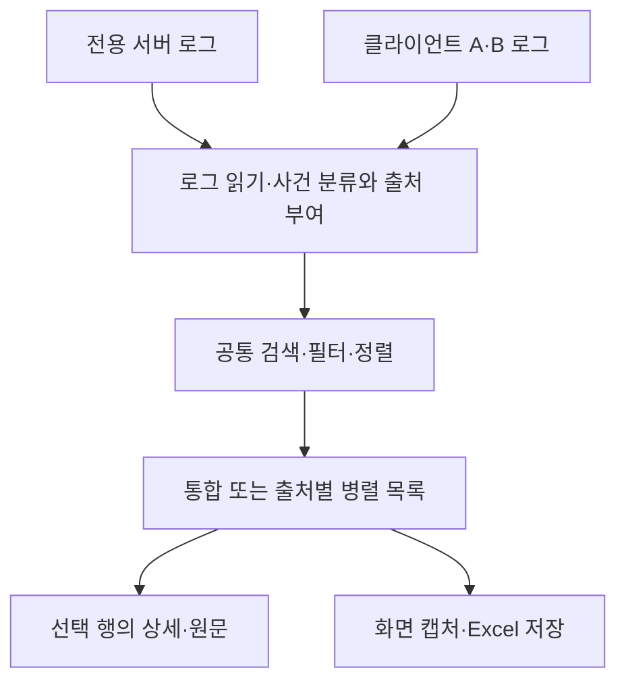

# 로그 뷰어 제작 사례

CoopRPG · 2026-11-19 정리 · V02 제작과 V07까지의 후속 보완

두 게임 창을 조작하면서 전용 서버의 판정과 양쪽 클라이언트의 복제를 확인하기 위해 읽기 전용 로그 뷰어를 만들었다. 사용자는 실제 플레이에서 구분하기 어려웠던 정보를 짚고, 목록과 상세의 일치와 화면 전환까지 확인 기준을 넓혔다.

**색인** · [문제와 계획](#problem) · [구조](#architecture) · [사용자 검토와 보완](#review) · [검증과 남은 범위](#verification)

## 문제와 계획

수동 멀티플레이 시험에서 사용자는 게임을 조작하는 동안 입력이 서버에서 승인됐는지, 양쪽에 어떤 상태가 복제됐는지 보기 어렵다고 지적했다. 원본은 각 프로세스의 파일에 있었다. 먼저 읽기 전용 실시간 창을 연결하고, 통합 보기와 출처별 병렬 보기로 관측 흐름을 비교하는 순서로 진행했다. 이후 선택한 사건의 상세·원문과 캡처·Excel 저장을 연결했다.

사용자가 정한 판단 기준은 **누가 요청하거나 행동했는지, 무엇이 대상인지, 어느 프로세스에서 관측했는지**를 구분할 수 있어야 한다는 것이었다. AI는 이 기준에 맞춰 로그 분류·표시와 필요한 계측을 구현했다. 사용자는 실제 두 창을 조작해 결과를 내보냈고, AI는 선택한 행과 수치를 원본 로그에 대조했다.

**근거** · [최초 수동 로그 창](../Validation/Index.md#v02-live-log-viewer) · [병렬 비교 결정과 시험](../Validation/Index.md#v02-viewer-parallel) · [AI 협업 근거 색인](../Portfolio/AICollaborationEvidence.md#log-viewer-case)

## 로그에서 검증 자료까지

뷰어는 같은 사건 집합에서 통합 목록과 출처별 목록을 만든다. 공통 행 비교는 동일 시각대의 서로 다른 관측을 나란히 보여준다. 기록된 `EventId`는 원문 한 행을 다시 찾는 식별자다. 공격 요청부터 복제까지를 하나로 묶는 요청 ID는 이 범위에서 미계측이다.

**근거** · [병렬 비교와 공통 행](../Validation/LogViewer.md#parallel) · [로그 표시 규칙](../Validation/LogViewer.md#logging-contract) · [로그 읽기](../../Tools/Validation/CombatLogReader.psm1) · [목록·식별값 구성](../../Tools/Validation/CombatLogViews.psm1) · [내보내기](../../Tools/Validation/CombatLogExport.psm1)

## 사용자 검토와 보완

### 상세에서 사건을 먼저 읽기

사용자는 서버 승인과 스태미나 복제 화면에서 사건명과 기록 함수가 추적 정보에 섞여 읽힌다고 지적했다. 사건 요약과 단계·결과, 요청자·행위자·역할, 이벤트·함수, 대상, 추적 정보·원문 순으로 읽을 수 있게 정리했다. AI는 같은 두 사건을 변경 전후에 재생하고 `EventId`와 원문이 일치하는지 확인했다. 이전 로그에는 요청자·역할의 미계측 상태를 표시했고, 이후 빌드에서 서버 요청자의 `PlayerId`와 클라이언트의 `LocalRole`을 기록했다.

**근거** · [같은 두 사건의 상세 전후 비교](../Validation/LogViewer.md#detail-before-after) · [요청자와 역할 계측](../Validation/LogViewer.md#player-attribution)

### 목록에서 식별한 값을 상세에서도 찾기

사용자는 체력 복제와 공용 상자 로그를 보면서, 로그가 나온 창만으로는 누구의 체력이나 어느 객체의 사건인지 구분하기 어렵다고 지적했다. 체력 소유자를 플레이어 1·2 또는 적으로 표시하고, 목록에 `관련 플레이어`와 `대상 객체`를 추가했다. 사용자는 상세에서도 같은 값을 보여 달라고 요청했다. AI는 동일한 상자 로그 9개 행을 단일·3분할에서 재생해 목록과 상세를 대조했다. A의 거리 이탈 닫기, B의 획득, 양쪽의 공용 상자 재고 복제가 구분됐다. 값이 기록되지 않은 행은 `—`로 남겼다.

**근거** · [체력 소유자 사용자 확인](../Validation/Index.md#v04-health-subject-user-result) · [11월 16일 목록·상세 확인과 캡처 위치](../Development.md#daily)

### 정적인 화면과 보기 전환을 함께 확인하기

사용자는 표의 정보 흐름을 보고 첫 줄 순서를 **검색 → 정렬 → 결과 │ 카테고리 │ 갱신 │ 상세·원문**으로 정했다. AI는 같은 83개 사건을 넓고 좁은 창에서 재생하고 그룹 단위 줄바꿈을 확인했다. 이후 사용자가 단일에서 분할로 갈 때 오류창이 뜬다고 보고했다. AI는 배치가 끝나기 전에 구분선을 동기화해 `SplitterDistance`에 허용 범위를 벗어난 값이 들어가는 것을 재현했다. 배치가 끝난 뒤 범위를 계산하도록 바꾸고 2·3·4분할과 상세 다시 열기를 검사했다. 사용자는 수정 후 세 분할 모드가 동작한다고 확인했고, AI의 회귀 검사는 53개를 통과했다.

**근거** · [첫 줄 순서와 전후 화면](../Validation/Index.md#v02-viewer-toolbar-order) · [분할 오류 재현·수정·재시험](../Validation/LogViewer.md#pane-splitter-transition)

## 검증과 남은 범위

대표 사용자 수동 실행에서 서버 승인 4건, 사거리 밖 거절 2건, 양쪽 클라이언트의 표적 HP 복제와 네트워크 역할을 원본에 대조했다. 이 실행에서는 요청자 번호와 관측 출처를 구분했고, 이후 V04의 두 창에서도 사용자가 플레이어 1·2와 적의 체력 표시를 구분했다. 상세창 또는 도구 모음의 전후 캡처는 같은 로그를 다시 표시한 시험 결과다. 분할 전환 예외는 별도의 회귀 시험으로 재현하고 수정했다.

**근거** · [사용자 수동 실행과 원본 파일 위치](../Validation/Index.md#v02-viewer-player-attribution-manual) · [V04 수동 검증](../Validation/Index.md#v04-health-subject-user-result)

### 화면과 원본 찾기

아래는 원본 작업 트리에 남은 로컬 경로다. 위의 저장소 검증 링크에서 같은 사례의 조건과 판정을 읽을 수 있다.

- **도구 모음 전후 화면** · `Artifacts/Validation/v02-viewer-toolbar-order-20261116-083556/`의 `before-layout/wide.png`와 `after-layout/wide.png`. 좁은 창은 같은 폴더들의 `narrow.png`.
- **목록과 상세의 식별값** · `Artifacts/Validation/v07-chest-distance-20261116-215413/viewer-object-columns/`의 `detail-wide.png`와 `detail-parallel.png`.
- **분할 오류의 원본** · `Artifacts/Validation/viewer-pane-switch-20261117/`의 `before-with-trace/failure.png`, `before-with-trace/winforms-exceptions.txt`, `chest-after/four-panes.png`.
- **이전 포트폴리오 HTML** · 원본 작업 트리의 `Artifacts/Documentation/CoopRPG-LogViewer-Case/index.html`. `manifest.json`의 기준은 `45a1876`과 당시 로컬 변경, V02 도구 모음 화면과 사용자 로그 재생이다. 편집본의 판본은 [README 문서 색인](../../README.md#document-editions)에 있다.

서버·클라이언트를 시작하고 회차 로그를 열어 주는 연결부는 [검증 실행기 제작 사례](ValidationLauncher.md)에 설명한다.
