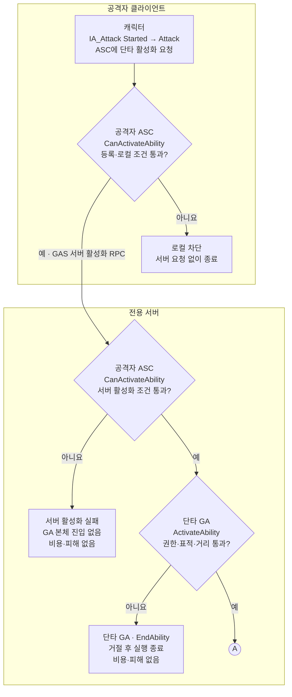
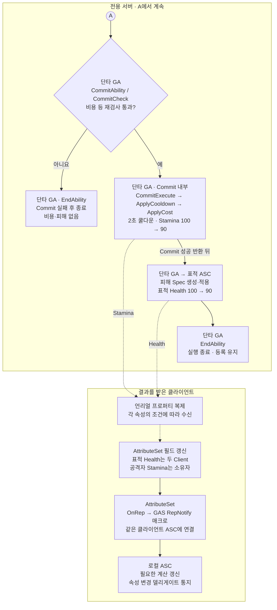

# CoopRPG의 GAS 단타 구현 읽기

CoopRPG · 2026-11-15 · UE 5.8.4 · V02 학습·구현 기록

**서버가 공격을 Commit하면 스태미나 10이 줄고, 타격을 확정하면 표적 체력이 10 줄어든다.** 이 문서는 입력부터 서버 판정·효과 적용·속성 복제까지를 실제 코드에 연결해 설명한다. Unreal의 Actor·Component와 C++ 함수 호출에 익숙하고, GAS와 CoopRPG는 처음 접하는 독자를 대상으로 한다.

현재 대상은 `L_Movement`의 **고정 표적 단타**다. 서버는 자신이 보유한 표적과 좌표로 공격을 판단한다. 클라이언트가 피해량이나 표적의 최종 체력을 지정하는 별도 RPC는 만들지 않았다. V02의 비용·쿨다운과 즉시 단타 흐름을 먼저 설명한다. 현재 코드의 명시 취소와 준비 구간은 아래 V03 절을 함께 참고한다.

- **ASC · Ability System Component** — 능력을 등록하고 활성화 요청·GE 적용·속성 변경 통지를 연결한다. 공격자와 표적이 각각 갖는다.
- **GA · Gameplay Ability** — 공격의 검사 → 비용 확정 → 피해 적용 → 종료 순서를 정의한다. 본체는 서버에서 실행한다.
- **GE · Gameplay Effect** — 스태미나 또는 체력을 어떤 연산과 크기로 변경할지 정의한다.
- **AttributeSet** — Health·Stamina 값을 보관하고 범위 제한과 복제 콜백을 구현한다. 전송은 언리얼 복제 시스템이 수행한다.

**확인한 결과** · 11월 15일 같은 PC의 독립 전용 Server 1개·Client 2개에서 클릭 4회에 서버 요청 4건, 거리 밖 거절 2건과 안쪽 승인 2건을 확인했다. 표적 체력은 양쪽에서 `100 → 90 → 80`, 각 공격자의 스태미나는 소유 클라이언트에서 `100 → 90`이었다. 후속 독립 패키지에서는 비용 부족·쿨다운의 실제 서버 거절을 요청자별5회씩 확인했다. [최신 시험과 한계](../Validation/Index.md#v02-cost-cooldown)를 참조한다.

**근거** · [패키지 입력 회귀의 조건과 결과](../Validation/Index.md#v02-attack-input-regression) · [현재 구현과 ASC 배치의 선택 이유](../Architecture.md#gas-basic-attack)

**읽는 순서**

1. [한 번의 클릭과 전체 흐름](#attack-flow)
2. [GA의 준비·등록·실행·종료](#ability-lifecycle)
3. [검사 위치와 비용 확정](#attack-checks)
4. [GE 정의·Modifier·Spec 적용](#effect-definition)
5. [AttributeSet의 매크로와 복제](#attribute-replication)
6. [실제 검증 범위와 로그 읽기](#verification-scope)
7. [V03의 준비·피해 확정·취소](#attack-cancellation)
8. [코드 읽는 순서와 근거](#engine-source)

<a id="attack-flow"></a>
## 1. 한 번의 클릭은 어디를 거치는가

먼저 **입력 → 로컬 사전 확인 → 서버 확인 → 비용·피해 → 복제**의 흐름을 읽는다. 두 그림의 **A**는 같은 실행의 연결 지점이다. 구획은 실행 위치, 블록 안은 **처리 주체 → 대표 함수 → 판단 또는 처리** 순서다. 마름모는 조건, 사각형은 처리·종료, 실선은 진행, 점선은 속성 복제 경로다. 여러 내부 호출을 대표 함수로 요약했으므로 모든 화살표가 직접적인 C++ 호출을 뜻하지는 않는다.

### 1-1. 입력부터 서버의 표적·거리 확인까지



왼쪽 클릭은 `IMC_Player`의 Boolean 액션 `IA_Attack`에 연결돼 있다. 캐릭터의 `SetupPlayerInputComponent`가 **`Started`를 `Attack`에 바인딩**한다. 현재 입력 구성에서는 처음 누르는 이벤트에 활성화를 요청한다. 이동의 `Triggered`처럼 누르는 동안 매 프레임 공격을 요청하는 구성이 아니다.

`Attack()`은 ASC의 `TryActivateAbilityByClass`를 호출한다. `ServerOnly` GA라도 소유 클라이언트는 등록 항목과 로컬 활성화 조건을 먼저 확인한다. 통과하면 GAS가 서버 활성화 RPC를 보낸다. 서버는 서버 상태로 다시 확인하며, 클라이언트에서 이 함수가 `true`를 반환하는 것만으로 피해 승인이 확정되지는 않는다.

**근거** · [입력 바인딩과 Attack](../../Game/Source/CoopRPG/Character/CoopRPGCharacter.cpp) · [서버 GA의 검사](../../Game/Source/CoopRPG/AbilitySystem/Abilities/CoopRPGMeleeAbility.cpp) · [엔진 활성화 경로](#engine-source)

### 1-2. 비용 확정부터 피해와 복제까지

아래 수치는 두 속성의 시작값이 100이고 다른 보정이 없는 **첫 승인 공격**의 예다. 비용은 `CommitAbility` 내부에서 적용되고, 피해는 그 함수가 성공을 반환한 뒤 적용된다.



두 점선이 합류하는 것은 경로를 간결하게 표현하기 위해서다. **Health와 Stamina는 개별 속성이며 한 묶음의 동시 전송이나 도착 순서를 보장하지 않는다.** `EndAbility`도 클라이언트의 복제 수신 완료를 기다리는 함수가 아니다. `Health는 두 Client`라는 표기는 현재 표적이 양쪽에 복제되는 시험 조건을 뜻한다.

그림을 표시하지 않는 뷰어에서는 다음과 같이 읽는다.

1. 로컬 확인 실패면 서버에 요청하지 않는다. 서버 활성화 확인 실패면 GA 본체에 진입하지 않는다.
2. 본체의 표적·거리 검사 또는 Commit 재검사 실패면 비용과 피해 없이 종료한다.
3. Commit 성공 시 공격자에게 쿨다운·비용을 적용하고, 이어서 표적에게 피해를 적용한다. 쿨다운 GE/태그 복제는 아래 AttributeSet의 Health/Stamina 복제와 별도 경로다.
4. 각 속성이 해당 클라이언트에 도착하면 OnRep가 로컬 GAS의 계산·알림 경로에 연결한다.

**근거** · [Commit·피해·종료의 실제 순서](../../Game/Source/CoopRPG/AbilitySystem/Abilities/CoopRPGMeleeAbility.cpp) · [속성별 복제 조건과 OnRep](../../Game/Source/CoopRPG/AbilitySystem/Attributes/CoopRPGCombatAttributes.cpp)

<a id="ability-lifecycle"></a>
## 2. GA는 어떻게 준비되고 다시 실행되는가

### 2-1. 클래스 기본값은 실행 방식을 정한다

`UCoopRPGMeleeAbility` 생성자는 다음 네 가지를 설정한다.

- **`InstancedPerActor`** — 이 ASC에 부여된 단타의 인스턴스를 실행 간 재사용한다. 클릭마다 새 능력을 부여하는 방식이 아니다.
- **`ServerOnly`** — 능력 본체를 서버에서 실행한다. 현재 공격은 클라이언트의 피해 예측을 하지 않는다.
- **`CostGameplayEffectClass`** — `UCoopRPGMeleeCost`를 비용 정의로 지정한다. 생성자에서 스태미나를 차감하는 것은 아니다.
- **`CooldownGameplayEffectClass`** — `UCoopRPGMeleeCooldown`을 지정한다. 승인 시 2초 GE가 공격자에게 `Cooldown.CoopRPG.Melee` 태그를 부여한다.

### 2-2. ASC·AttributeSet 준비와 ActorInfo 연결

캐릭터와 고정 표적은 생성자에서 ASC와 AttributeSet을 기본 서브오브젝트로 만든다. ASC는 복제를 켜고 `Minimal` 모드를 사용한다. **`Minimal`은 활성 GE의 복제 방식에 관한 설정이며, Health·Stamina의 수신 범위는 별도의 프로퍼티 복제 조건으로 정한다.**

엔진의 `UAbilitySystemComponent::InitializeComponent`는 소유 Actor의 AttributeSet 서브오브젝트를 찾아 등록한다. 따라서 현재 구성에서는 별도의 수동 등록 코드가 없다. 프로젝트는 각 Actor의 `BeginPlay`에서 `InitAbilityActorInfo(this, this)`를 호출해 다음 관계를 설정한다.

| ActorInfo 항목 | 현재 의미 |
|---|---|
| `OwnerActor` | ASC를 소유하는 Actor. 공격자는 캐릭터, 표적은 표적 Actor다. |
| `AvatarActor` | 능력을 실행하는 몸체. 현재는 각각 자신의 OwnerActor와 같다. |
| `AbilitySystemComponent` | 해당 주체의 ASC. GA에서 공격자 ASC를 찾는 데 쓴다. |

캐릭터의 `NotifyControllerChanged`는 ActorInfo를 갱신하며 능력을 다시 부여하지 않는다. ASC를 캐릭터에 둔 이유는 현재 전투 상태의 수명을 Pawn에 맞추기 위해서다. Pawn 교체 후에도 능력·효과를 유지해야 할 경우의 PlayerState 배치와 비교는 설계 문서에서 다룬다.

**근거** · [캐릭터의 생성·초기화](../../Game/Source/CoopRPG/Character/CoopRPGCharacter.cpp) · [고정 표적의 초기화](../../Game/Source/CoopRPG/Combat/CoopRPGAttackTarget.cpp) · [ASC 배치와 전투 상태의 수명](../Architecture.md#gas-basic-attack)

### 2-3. 서버가 능력을 부여하고, 입력은 등록된 능력을 찾는다

캐릭터 `BeginPlay`의 `HasAuthority()` 분기에서 `GiveAbility(FGameplayAbilitySpec(UCoopRPGMeleeAbility::StaticClass()))`를 호출한다. **`FGameplayAbilitySpec`은 ASC의 능력 등록 항목**이다. 현재 생략한 인수의 기본값은 레벨 1, `InputID = INDEX_NONE`, `SourceObject = nullptr`다. 표적에는 이 단타 GA를 부여하지 않는다.

입력은 Enhanced Input에서 받고, `TryActivateAbilityByClass`가 등록된 클래스의 Spec을 찾은 뒤 Handle로 활성화를 시도한다. `CanActivateAbility`는 실행 가능 여부를 확인하고, `ActivateAbility`는 조건을 통과한 실행의 본체다. `IsActive()`는 이미 실행 중인지를 조회하므로 두 질문을 구분해야 한다.

### 2-4. 실행 본체가 받는 네 가지 정보

다음은 실제 override의 매개변수다. 선언 형식은 유지하고 줄바꿈만 조정했다.

```cpp
virtual void ActivateAbility(
    FGameplayAbilitySpecHandle Handle,
    const FGameplayAbilityActorInfo* ActorInfo,
    FGameplayAbilityActivationInfo ActivationInfo,
    const FGameplayEventData* TriggerEventData) override;
```

- **`Handle` — 어떤 등록 항목인가.** 서버가 부여한 Spec의 식별자다. 클릭마다 새로 생기는 공격 번호가 아니다.
- **`ActorInfo` — 누가 실행하는가.** 현재 코드는 `AvatarActor`로 공격 Pawn을, `AbilitySystemComponent`로 공격자 ASC를 찾는다.
- **`ActivationInfo` — 이번 실행은 어떤 상태인가.** 실행 모드와 예측 키 등의 활성화 정보를 담는다. 현재 코드는 Commit과 종료에 전달한다. 인수가 존재한다는 사실만으로 클라이언트 피해 예측을 사용하는 것은 아니다.
- **`TriggerEventData` — 어떤 이벤트가 실행을 시작했는가.** 이벤트 기반 실행이면 발신자·대상·태그 등을 전달할 수 있다. 현재 클릭 경로는 이벤트 페이로드 없이 클래스로 활성화하며 이 인수를 사용하지 않는다.

### 2-5. 종료는 이번 실행을 닫는다

현재 GA는 검사와 효과 적용을 한 번 수행하고 `EndAbility`를 호출한다. 등록된 Spec은 남아 다음 클릭에도 사용된다. 정상 경로의 마지막 두 인수는 `false, false`, 본체의 거절 경로는 `false, true`다.

| 종료 인수 | 의미 |
|---|---|
| `bReplicateEndAbility` | 이번 종료를 네트워크로 전파할지 정한다. 현재 서버 전용 실행에서는 `false`다. |
| `bWasCancelled` | 취소로 정리하는 종료인지 표시한다. 본체의 거절은 `true`, 정상 완료는 `false`다. |

`CancelAbility`는 취소 가능 여부를 확인하고 취소 통지를 거쳐 실행을 끝내는 경로다. 현재 코드가 실패 시 `EndAbility(..., false, true)`를 호출한다는 사실은 **공격 도중 피격 취소·몽타주 정리·재실행을 구현하고 검증했다는 뜻이 아니다.**

**근거** · [GA의 선언](../../Game/Source/CoopRPG/AbilitySystem/Abilities/CoopRPGMeleeAbility.h) · [클래스 설정과 모든 종료 분기](../../Game/Source/CoopRPG/AbilitySystem/Abilities/CoopRPGMeleeAbility.cpp) · [Epic의 능력 수명](https://dev.epicgames.com/documentation/en-us/unreal-engine/using-gameplay-abilities-in-unreal-engine)

<details>
<summary>보충 — 능력 제거와 추가 함수 인수</summary>

서버는 `ClearAbility(Handle)`로 등록을 제거할 수 있다. `SetRemoveAbilityOnEnd`는 실행 중이면 종료 뒤 제거하고, 실행 중이 아니면 즉시 제거한다. `OnGiveAbility`·`OnRemoveAbility`는 관련 확장 지점이며 현재 프로젝트에서는 재정의하지 않았다.

무기 장착으로 능력 목록이 바뀐다면 서버가 장착 시 부여하고 해제 시 저장한 Handle로 제거할 수 있다. 기본 능력을 계속 부여하고 서버에서 장착 조건만 검사하는 선택도 가능하다. 현재 단타에는 장착별 부여·제거와 장착 판정이 없다.

`TryActivateAbilityByClass`의 `bAllowRemoteActivation`은 기본값이 `true`이며 필요한 원격 활성화 요청을 허용한다. `CanActivateAbility`에는 `Handle`·`ActorInfo` 외에 선택적인 출발·대상 태그와 실패 태그 출력이 있다. 이 태그 검사가 표적 검색이나 거리 계산까지 해주는 것은 아니다. `CommitAbility`는 `Handle`·`ActorInfo`·`ActivationInfo`와 선택적 실패 태그 출력을 받는다.

**근거** · [Epic GA API](https://dev.epicgames.com/documentation/en-us/unreal-engine/API/Plugins/GameplayAbilities/UGameplayAbility) · [장착에 따른 능력 관리 사례인 Lyra](https://dev.epicgames.com/documentation/en-us/unreal-engine/abilities-in-lyra-in-unreal-engine)

</details>

<a id="attack-checks"></a>
## 3. 어디서 거절하고 언제 스태미나를 차감하는가

### 3-1. 서버는 활성화 조건과 실제 공격 조건을 나눠 확인한다

로컬 ASC는 등록된 Spec과 `CanActivateAbility`를 확인한다. 서버도 요청을 받으면 서버의 상태로 활성화를 검사한다. 기본 구현은 역할·태그·비용·쿨다운 등 GAS 조건을 다루며, 현재 GA는 `CanActivateAbility`를 재정의하지 않는다.

이후 서버의 `ActivateAbility`는 다음 순서로 게임 규칙을 확인한다.

1. 공격 Pawn과 공격자 ASC가 유효하고 Pawn에 서버 권한이 있는가.
2. 서버 GameMode가 제공하는 고정 표적이 유효하고 `Health > 0`인가.
3. 서버의 두 Actor 원점 사이 **수평 거리 `Dist2D`가 250cm 이하인가.**

고도 차이, 장애물, 공격 방향, 무기 충돌과 장착 여부는 아직 검사하지 않는다. 이 선택은 고정 표적으로 GAS의 권한·비용·복제를 먼저 확인하기 위한 현재 구현 범위다.

### 3-2. Commit은 비용을 다시 검사한 뒤 사용을 확정한다

기본 `CommitAbility`는 `CommitCheck`를 통과하면 `CommitExecute`에서 설정된 쿨다운과 비용을 적용한다. 현재 GA에는 **비용 GE와 2초 쿨다운 GE**가 설정돼 있다. 승인 경로에서는 이 과정에서 공격자 스태미나를 10 소모한 뒤, GA 본체가 피해 Spec을 만들어 표적 ASC에 적용한다.

기본 Additive 비용 검사는 `CurrentValue + CostValue < 0`이면 실패한다. 비용이 `-10`인 현재 설정의 경계는 다음과 같다.

| 검사 직전 Stamina | 비용 검사 기대값 |
|---:|---|
| 9 | 실패. 비용·피해 없이 종료해야 한다. |
| 10 | 통과. 나머지 조건도 유효하면 비용 적용 뒤 0이 된다. |
| 100 | 통과. 나머지 조건도 유효하면 비용 적용 뒤 90이 된다. |

**9·10 경계는 후속 독립 패키지에서 두 요청자 모두 실행 확인했다.** 활성화 사전 검사에서 이미 거절될 수 있으므로 비용 부족이 항상 `CommitFailed`로 기록되지는 않는다. Commit 성공 뒤 피해 효과가 적용되지 않더라도 비용을 자동 환불하는 트랜잭션은 아니다.

쿨다운 GE는 `HasDuration`·2초이며 `UTargetTagsGameplayEffectComponent`로 차단 태그를 부여한다. `EndAbility` 뒤에도 효과는 유지되고 만료 후 다시 실행할 수 있다. 거절 요청은 새 효과를 적용하지 않으므로 기존 쿨다운을 연장하지 않는다. 플레이어 ASC는 Mixed로 소유자에게 활성 GE를 전달한다. Minimal이었던 첫 시험에서 소유자 쿨다운 태그가 누락된 결과와 수정 후 [재검증](../Validation/Index.md#v02-cost-cooldown)을 구분한다. 관찰 클라이언트는 해당 플레이어의 GE 전체를 받지 않으며, 속성 HP/Stamina의 복제 조건도 GE 복제 모드와 별개다.

### 3-3. 실패 위치를 로그로 구분한다

| 실패 위치 | 현재 관찰할 수 있는 것 |
|---|---|
| 클라이언트 사전 확인 | 비용·쿨다운 실패는 `AttackBlocked Reason=Cost/Cooldown`, `AttackDispatch Submitted=0`이다. 입력 로그만으로 전송 성공을 판정하지 않는다. |
| 서버 활성화 확인 | GA 본체 진입 전 비용·쿨다운 실패도 CheckCost/CheckCooldown의 `AttackRejected Reason=Cost/Cooldown`으로 기록한다. NetMode와 실제 GAS 요청을 함께 확인한다. |
| 본체의 초기 권한·참조 확인 | `EndAbility` 후 반환한다. 현재 이 분기에는 별도 `AttackRejected` 로그가 없다. |
| 본체의 표적·거리 확인 | 각각 `Reason=InvalidTarget`, `Reason=OutOfRange`다. Commit 전에 종료한다. |
| 본체의 Commit 재검사 | 실패 시 `Reason=CommitFailed`다. 피해 Spec을 만들거나 적용하지 않는다. |

**근거** · [검사·로그·Commit 호출부](../../Game/Source/CoopRPG/AbilitySystem/Abilities/CoopRPGMeleeAbility.cpp) · [엔진의 활성화·비용 계산 경로](#engine-source) · [다음 V02 검증 카드](../Roadmap.md#next-work)

<a id="effect-definition"></a>
## 4. GE는 어떻게 구성하고 누구에게 적용하는가

### 4-1. GE 정의와 Spec은 역할이 다르다

**GE 클래스는 효과의 정의이고 `FGameplayEffectSpec`은 이번 적용에 사용할 실행 데이터다.** Spec은 정의의 참조, 레벨, 효과 컨텍스트와 Modifier 평가 데이터 등을 갖는다. 컨텍스트에는 효과를 일으킨 주체 등의 정보가 담길 수 있으며, 수신 대상 ASC는 적용 호출에서 지정한다.

GA 등록에 쓰던 `FGameplayAbilitySpec`과도 구분해야 한다. Ability Spec은 **사용 가능한 능력의 등록 항목**, Effect Spec은 **적용할 효과의 실행 데이터**다.

### 4-2. 수치를 바꾸는 두 GE의 설정

| 항목 | 비용 GE | 피해 GE |
|---|---|---|
| 클래스 | `UCoopRPGMeleeCost` | `UCoopRPGMeleeDamage` |
| 수신 ASC | 공격자 | 고정 표적 |
| GE 기간 정책 | `Instant` | `Instant` |
| Modifier 대상 속성 | `GetStaminaAttribute()` | `GetHealthAttribute()` |
| 연산 | `Additive` | `Additive` |
| 크기 | 고정 `-10` | 고정 `-10` |

`DurationPolicy`는 GE 전체의 수명이다. `Modifiers`는 속성 변경 규칙의 목록이며 위 두 수치 GE에 하나씩 들어 있다. 쿨다운 GE에는 수치 Modifier가 없다. **Modifier 하나는 대상 속성(`Attribute`), 연산(`ModifierOp`), 크기와 계산 방식(`ModifierMagnitude`)을 묶는다.** 두 효과는 `FScalableFloat(-10.0f)`를 사용하며 레벨별 커브를 연결하지 않았다.

`FGameplayModifierInfo`에는 평가 채널과 소스·대상 태그 조건도 있지만 현재는 별도 설정이 없다. 효과를 늘릴 때는 GE 자체의 적용 조건과 개별 Modifier의 평가 조건을 구분해야 한다. 지금은 C++ 생성자에서 정의했으며 데이터 전용 GE Blueprint로 설정하는 방법도 있다.

### 4-3. 쿨다운 GE는 태그의 수명을 관리한다

`UCoopRPGMeleeCooldown`은 수치 Modifier 없이 2초 동안 공격자에 태그를 부여한다. 현재는 C++ 기본 서브오브젝트인 `UTargetTagsGameplayEffectComponent`에 태그를 설정한다. GA의 기본 `CheckCooldown`은 이 효과의 부여 태그와 ASC가 가진 태그를 대조한다. 프로젝트의 override는 `Super` 판정을 유지하고 실패 위치만 기록한다.

**근거** · [세 GE의 실제 정의](../../Game/Source/CoopRPG/AbilitySystem/Effects/CoopRPGMeleeEffects.cpp) · [검사와 적용](../../Game/Source/CoopRPG/AbilitySystem/Abilities/CoopRPGMeleeAbility.cpp)

### 4-4. 피해 Spec을 표적 ASC에 적용한다

아래는 서버 GA의 실제 C++ 코드이며 줄바꿈만 조정했다.

```cpp
const FGameplayEffectSpecHandle Damage =
    MakeOutgoingGameplayEffectSpec(UCoopRPGMeleeDamage::StaticClass());
check(Damage.IsValid());
Source->ApplyGameplayEffectSpecToTarget(
    *Damage.Data.Get(), Target->GetAbilitySystemComponent());
```

`Source`는 공격자 ASC, 두 번째 인수는 표적 ASC다. 표적 ASC가 피해 정의를 실행하면서 **표적 AttributeSet의 Health**를 바꾼다. 공격자 Stamina는 앞선 Commit의 **별도 비용 GE**로 바뀐다. 비용과 피해를 분리한 이유는 수신 ASC와 적용 책임이 다르기 때문이다.

현재는 다른 수치 보정이 없고 위 비용·피해 GE 모두 `Instant`이므로 각 대상 속성의 BaseValue와 CurrentValue가 함께 감소한다. 피해 GE 하나가 Health와 Stamina를 동시에 깎는 구조가 아니다.

**근거** · [GE 생성자와 Modifier 구성](../../Game/Source/CoopRPG/AbilitySystem/Effects/CoopRPGMeleeEffects.cpp) · [Spec 생성·적용 코드](../../Game/Source/CoopRPG/AbilitySystem/Abilities/CoopRPGMeleeAbility.cpp) · [Epic의 GE와 Spec 설명](https://dev.epicgames.com/documentation/en-us/unreal-engine/gameplay-effects-for-the-gameplay-ability-system-in-unreal-engine) · [Modifier API](https://dev.epicgames.com/documentation/unreal-engine/API/Plugins/GameplayAbilities/FGameplayModifierInfo)

<a id="attribute-replication"></a>
## 5. AttributeSet의 선언·매크로·복제는 어떻게 연결되는가

### 5-1. 값은 어느 객체에 있는가

`UCoopRPGCombatAttributes`에는 `FGameplayAttributeData` 타입의 `Health`와 `Stamina`가 있다. 각 필드는 **BaseValue와 CurrentValue**를 갖고 생성자에서 둘 다 100으로 시작한다. 이번 공격에서 공격자와 표적의 AttributeSet은 서로 다른 객체다.

- 공격자에게 비용 GE 적용 → 공격자 **Stamina의 Base·Current가 각각 100 → 90**.
- 표적에게 피해 GE 적용 → 표적 **Health의 Base·Current가 각각 100 → 90**.

`GetHealth()`가 읽는 곳은 이 AttributeSet의 Health다. 표적 Actor의 같은 이름 함수는 자신의 AttributeSet에 조회를 위임한다. AttributeSet 안의 `OnRep_Health`에서 인수 없이 부르는 `GetHealth()`는 **그 AttributeSet 객체에 생성된 멤버 함수**다.

### 5-2. 매크로가 만드는 접근자와 직접 작성하는 콜백

다음은 실제 헤더에서 Health 관련 부분만 발췌한 C++ 코드다. 생략한 클래스 구문과 접근 지정자는 원본에서 확인할 수 있다.

```cpp
GAMEPLAYATTRIBUTE_PROPERTY_GETTER(UCoopRPGCombatAttributes, Health)
GAMEPLAYATTRIBUTE_VALUE_GETTER(Health)

UFUNCTION()
void OnRep_Health(const FGameplayAttributeData& PreviousHealth);

UPROPERTY(ReplicatedUsing = OnRep_Health)
FGameplayAttributeData Health;
```

- `GAMEPLAYATTRIBUTE_PROPERTY_GETTER`는 `static FGameplayAttribute GetHealthAttribute()`를 만든다. GE가 변경할 **속성의 식별자**를 얻거나 범위 제한 함수에서 속성을 비교할 때 쓴다.
- `GAMEPLAYATTRIBUTE_VALUE_GETTER`는 `float GetHealth() const`를 만든다. 해당 객체의 **현재 숫자 CurrentValue**를 읽는다.
- `UPROPERTY(ReplicatedUsing = OnRep_Health)`는 Health의 복제 콜백을 지정한다. `OnRep_Health`의 선언과 본문은 개발자가 직접 작성하고 `UFUNCTION()`으로 노출한다.
- 클래스의 `UCLASS()`·`GENERATED_BODY()`는 언리얼 리플렉션을 위한 선언이다. GAS의 위 두 접근자 매크로는 별도의 C++ 편의 코드다.

Stamina에도 같은 방식의 식별자 getter·현재값 getter·직접 작성한 OnRep가 있다. 이 클래스는 `GAMEPLAYATTRIBUTE_VALUE_SETTER`와 `GAMEPLAYATTRIBUTE_VALUE_INITTER`를 쓰지 않으므로 `SetHealth`·`InitHealth`와 대응 스태미나 함수는 이 선언에서 자동 생성되지 않는다. 초기값은 생성자에서, 전투 중 변경은 GE에서 처리한다.

### 5-3. 복제 조건과 재정의 함수

`GetLifetimeReplicatedProps`는 엔진 가상 함수를 **재정의**한 것이다. 그 안의 `DOREPLIFETIME_CONDITION_NOTIFY`가 필드와 수신 조건·통지 정책을 복제 목록에 등록한다.

| 필드 | 수신 조건 | 복제 콜백 |
|---|---|---|
| Health | `COND_None` — 해당 Actor가 복제되는 연결 | `OnRep_Health` |
| Stamina | `COND_OwnerOnly` — 소유 연결 | `OnRep_Stamina` |

둘 다 `REPNOTIFY_Always`를 사용한다. **프로퍼티를 복제로 수신했을 때 값이 같아 보여도 콜백을 실행하도록 하는 정책**이다. 매 프레임 전송하거나 복제 대상을 늘리는 설정이 아니다. 현재 시험에서는 표적 Health를 두 Client가 받고 공격자 Stamina를 해당 소유자만 받는다.

또 다른 override인 `PreAttributeBaseChange`는 변경할 Base 값을 참조 인수 `NewValue`로 받아 0~100으로 제한한다. 효과 적용 승인이나 사망 처리를 담당하지 않으며, 지속 효과로 계산된 모든 Current 값의 상한까지 보장하지 않는다. `PreAttributeChange`·`PreGameplayEffectExecute`·`PostGameplayEffectExecute`는 현재 재정의하지 않았다.

**근거** · [AttributeSet 선언](../../Game/Source/CoopRPG/AbilitySystem/Attributes/CoopRPGCombatAttributes.h) · [생성자·복제 등록·범위 제한](../../Game/Source/CoopRPG/AbilitySystem/Attributes/CoopRPGCombatAttributes.cpp) · [표적 Actor의 getter 위임](../../Game/Source/CoopRPG/Combat/CoopRPGAttackTarget.cpp)

### 5-4. Health 100 → 90에서 RepNotify가 하는 일

지속 보정과 예측이 없고 클라이언트도 변경 전 Health 100을 가진 현재 단타 예시다.

1. **서버에서 변경** — 피해 GE가 표적 Health를 90으로 만든다.
2. **클라이언트 필드 갱신** — 언리얼 복제가 클라이언트 AttributeSet의 Health를 갱신한다. `OnRep_Health` 진입 시 `PreviousHealth.GetCurrentValue()`는 100, `GetHealth()`는 이미 90이다.
3. **로컬 GAS에 연결** — OnRep 본문의 `GAMEPLAYATTRIBUTE_REPNOTIFY`가 새 값과 옛 값을 **같은 클라이언트의 ASC**에 전달한다. 이 매크로는 함수를 새로 선언하거나 서버에 수신 확인을 보내지 않는다.
4. **계산과 알림** — 엔진은 해당 속성의 Aggregator 유무에 따라 계산 상태를 갱신하거나 등록된 속성 변경 델리게이트에 이전·현재 값을 통지한다.

```text
Health의 ReplicatedUsing 설정
    → 언리얼 복제로 Health 필드 갱신
    → 직접 작성한 OnRep_Health(PreviousHealth)
    → GAMEPLAYATTRIBUTE_REPNOTIFY
    → 로컬 ASC의 SetBaseAttributeValueFromReplication
    → 필요한 계산 갱신과 속성 변경 통지
```

**왜 매크로가 필요한가?** 이 단순 예에서는 매크로를 빼도 직접 읽은 `GetHealth()`와 체력 로그는 90일 수 있다. 그러나 `GetGameplayAttributeValueChangeDelegate`만 구독한 체력바에는 그 복제 이벤트의 알림이 전달되지 않는다. 따라서 getter 숫자가 맞는 것만으로 GAS의 변경 알림도 정상이라고 판단할 수 없다. 체력바는 현재 미구현이고, 매크로 제거 실험도 하지 않았다. 이 차이는 엔진 코드에서 확인한 동작이다.

<details>
<summary>보충 — BaseValue·CurrentValue와 Aggregator</summary>

BaseValue는 계산의 기준값, CurrentValue는 적용 가능한 보정을 반영한 현재 값이다. 예를 들어 공격력 Base 100에 일시 Additive +20이 있으면 Current는 120이다. 버프 중 Base가 130으로 바뀌면 Current는 150, 버프가 끝나면 남은 조건으로 다시 계산해 130이 된다. 처음 값 100을 저장했다가 되돌리는 방식이 아니다. 이 공격력 예시는 원리 설명이며 현재 CoopRPG에 구현한 기능은 아니다.

Aggregator는 속성의 기준값과 Modifier를 평가하는 GAS 내부 계산 객체다. AttributeSet의 Health와 무관한 별도 체력 저장소로 이해하면 안 된다. 지속 보정이나 속성 캡처 등 GAS 내부 경로가 만들 수 있으므로, 존재 여부를 `Instant / Duration` 구분만으로 단정하지 않는다.

`SetBaseAttributeValueFromReplication`에서 Aggregator가 없으면 새·옛 CurrentValue로 등록된 변경 델리게이트에 알린다. 있으면 이전 Base로 알림에 쓸 이전 평가값을 구성하고, 새 서버 Base를 반영한 뒤 `OnAttributeAggregatorDirty` 경로로 계산·알림을 갱신한다. 실제 반영할 보정은 해당 클라이언트가 가진 효과와 예측 상태에 따른다. 현재 단타의 확인 수치와 이 일반 동작 설명을 구분한다.

참고로 setter 매크로는 ASC를 통해 Base 값을 설정하고, initter 매크로는 필드의 Base·Current를 초기화한다. 현재 AttributeSet에서 두 매크로를 사용한 것은 아니다.

</details>

**근거** · [프로젝트의 OnRep 본문](../../Game/Source/CoopRPG/AbilitySystem/Attributes/CoopRPGCombatAttributes.cpp) · [엔진 매크로·복제 처리의 확인 위치](#engine-source) · [Epic의 AttributeSet과 복제 예시](https://dev.epicgames.com/documentation/en-us/unreal-engine/gameplay-attributes-and-attribute-sets-for-the-gameplay-ability-system-in-unreal-engine)

<a id="verification-scope"></a>
## 6. 무엇을 실제로 확인했고 무엇이 남았는가

### 6-1. 실행 조건별로 결과를 읽는다

아래1~4는 기존 시험 이력이고5는 이번 구현 후 실행이다. 이전 사용자 PIE 확인을 새 쿨다운의 사람 확인으로 승계하지 않는다.

1. **입력 통합 후 독립 패키지** — 같은 PC·루프백의 Server 1개와 Client 2개. AI의 입력 주입으로 이동, 클릭 4회·서버 요청 4건, 거절·승인 각 2건을 확인했다. [패키지 시험 근거](../Validation/Index.md#v02-attack-input-regression)
2. **GAS 소스 이동 후 Editor 회귀** — 새 DLL로 Editor 실행 파일의 서버 1개·게임 2개를 기동했다. 거절·승인 각 2건과 동일한 속성 변화를 확인했다. 이동 후 독립 패키지 재빌드는 미실행이다. [소스 이동 회귀 근거](../Validation/Index.md#v02-gas-source-layout)
3. **로그 문맥 검증** — 단일 프로세스 PIE의 서버·두 Client와 별도 Editor 프로세스 시험을 구분해 수행했다. 입력·서버 판정·OnRep의 NetMode·PIE·함수명을 확인했다. [로그 검증 근거](../Validation/Index.md#v02-log-context)
4. **사용자 수동 PIE 확인** — 사용자가 두 창에서 조작한 Output Log를 대조했다. 입력 4건·서버 판정 4건, 거절·승인 각 2건을 확인했다. RPC 호출 수의 직접 근거는 앞선 자동 시험이다. [수동 확인 근거](../Validation/Index.md#v02-manual-attack-result)

5. **비용·쿨다운 후 독립 패키지** — 비용9/10, 실제 서버 거절, 정상 입력의 로컬 차단, 만료·재사용·독립성과 정상3회 및 기존 이동·거리 회귀를 확인했다. 소유자 쿨다운 복제 실패와 Mixed 수정 후 통과를 별도 보존했다. Editor 갱신과 사용자 재현은 대기다. [최신 시험](../Validation/Index.md#v02-cost-cooldown)

승인 두 건에서 **표적 Health는 양쪽에서** `100 → 90 → 80`, **각 요청자의 Stamina는 소유 클라이언트에서** `100 → 90`이었다. 거리 밖 두 거절에서는 체력과 비용이 변하지 않았다. 사용자 수동 확인의 거절 거리는 351.75cm·351.58cm, 승인 거리는 87.50cm·74.12cm였다. 각 시험의 입력 순서·빌드·실행 ID는 연결한 검증 기록에 둔다.

### 6-2. 입력·판정·복제 로그를 연결해서 본다

| 로그 | 입증하는 지점 |
|---|---|
| `AttackInput` · Verbose | 로컬 `Attack()` 진입. 서버 수신이나 피해 승인을 단독으로 입증하지 않는다. |
| `AttackBlocked` / `AttackDispatch` | 로컬 비용·쿨다운 차단과 요청 제출 여부. Submitted=1은 서버 승인 보장이 아니다. |
| `AttackRejected` / `AttackApproved` | 서버 GAS 검사 또는 GA 본체의 판정. Func·이유·승인 전후값과 복제 결과를 함께 확인한다. |
| `CombatSnapshot` / `CooldownChanged` | 개발용 상태 스냅샷과 태그 수명. 실제 서버 요청·거절과 함께 읽는다. |
| `HealthReplicated` / `StaminaReplicated` | 해당 클라이언트 AttributeSet의 OnRep 실행과 값. 어느 월드의 로그인지 함께 읽는다. |

같은 액터 이름이 여러 PIE 월드에 나타날 수 있어 **실행 문맥**인 `NetMode`·`PIE`·`Func`를 함께 본다. 공격 입력은 `Log LogCoopRPGInput Verbose`, GAS 서버 활성화 호출은 `AbilitySystem.ServerRPCBatching.Log 1`로 관찰할 수 있다. 정확한 실행 순서와 필터는 기존 수동 가이드를 따른다.

**근거** · [수동 실행과 로그 필터](../Validation/Index.md#v02-manual-attack-log) · [로그 문맥 구현](../../Game/Source/CoopRPG/Debug/CoopRPGLogContext.cpp)

### 6-3. 경계 검증을 분리하는 이유

비용 부족과 쿨다운은 로컬 차단·실제 서버 거절을 나눠 확인했다. 개발용 `Coop.Test.Request`는 소유 클라이언트에서 기존 GAS 활성화 RPC를 보내며 서버 검사를 끄지 않는다. 표적 사망이 비용 시험을 가리지 않도록 `Coop.Test.Prepare`로 표적을 살린 채 자원만9로 만든다. 두 명이 동시에 초기화하면 공용 표적 결과가 섞이므로 시험 준비를 순서대로 한다. [직접 재현 순서](../Validation/Index.md#v02-cost-cooldown-manual)를 따른다.

V03에서는 피해 확정 전 명시 취소와 재공격을 검증했다. 실제 물리 접촉 중복, 피격 자동 취소와 라운드 연계는 별도 확인 단계다.

**근거** · [다음 작업](../Roadmap.md#next-work) · [V02 등 단계별 통과 기준](../Validation/Index.md#active-tests) · [계획한 반복·네트워크 조건](../Validation/Index.md#test-conditions)

<a id="attack-cancellation"></a>
## 7. V03의 준비·피해 확정·취소

서버의 `CommitAbility`가 비용과 쿨다운을 적용한 뒤 0.65초를 기다린다. `ResolveHit`는 해당 공격의 대기 상태를 소비하고 표적·생존·사거리를 다시 검사한다. 조건이 유지될 때 표적 ASC에 피해 GE를 적용한다. 오른쪽 클릭으로 접수한 취소는 활성 단타의 `CancelAbilityHandle`을 거쳐 `EndAbility`에서 타이머와 표적 참조를 정리한다. 취소가 피해 확정 전에 수락되면 피해가 없으며 이미 적용한 비용과 쿨다운은 유지한다.

**근거** · [서버 취소와 피해 확정 검증](../Validation/Index.md#v03-attack-lifetime) · [현재 단타 코드](../../Game/Source/CoopRPG/AbilitySystem/Abilities/CoopRPGMeleeAbility.cpp)

<a id="engine-source"></a>
## 근거 및 더 읽기

### 프로젝트 코드를 따라가는 순서

1. [CoopRPGCharacter.cpp](../../Game/Source/CoopRPG/Character/CoopRPGCharacter.cpp) — 생성자·`BeginPlay`에서 ASC와 능력을 준비하고, `SetupPlayerInputComponent`·`Attack`에서 입력을 연결한다.
2. [CoopRPGMeleeAbility.cpp](../../Game/Source/CoopRPG/AbilitySystem/Abilities/CoopRPGMeleeAbility.cpp) — 서버의 검사·Commit·피해·종료 순서를 읽는다.
3. [CoopRPGMeleeEffects.cpp](../../Game/Source/CoopRPG/AbilitySystem/Effects/CoopRPGMeleeEffects.cpp) — 비용·피해 GE의 대상 속성·연산·크기를 확인한다.
4. [CoopRPGCombatAttributes.h](../../Game/Source/CoopRPG/AbilitySystem/Attributes/CoopRPGCombatAttributes.h)와 [구현](../../Game/Source/CoopRPG/AbilitySystem/Attributes/CoopRPGCombatAttributes.cpp) — 생성 접근자·직접 작성 콜백·복제 조건·값 제한을 연결한다.
5. [고정 표적](../../Game/Source/CoopRPG/Combat/CoopRPGAttackTarget.cpp)과 [검증 색인](../Validation/Index.md#v02-basic-attack) — 피해를 받는 ASC와 실행 결과를 대조한다.

### 직접 대조한 엔진 구현

동작 설명은 프로젝트가 사용하는 **UE 5.8.4 소스**와 대조했다. 아래 경로는 엔진 루트의 `Engine/Plugins/Runtime/GameplayAbilities/Source/GameplayAbilities/`를 기준으로 한다. 엔진 소스는 이 저장소에 포함하지 않으며, 같은 버전 소스에서 파일과 심볼을 검색할 수 있다. 공식 웹 문서는 기본 표시 버전이 달라질 수 있으므로 개념 설명과 확장 참고로 사용한다.

- **`Public/AttributeSet.h`** — 접근자 매크로, `GAMEPLAYATTRIBUTE_REPNOTIFY`의 실제 확장.
- **`Public/GameplayAbilitySpec.h`** — 능력 등록 Spec의 기본 인수.
- **`Private/AbilitySystemComponent_Abilities.cpp`** — `InitializeComponent`, `TryActivateAbilityByClass`, `TryActivateAbility`, `InternalServerTryActivateAbility`, `InternalTryActivateAbility`. AttributeSet 등록과 요청·활성화 경로.
- **`Private/Abilities/GameplayAbility.cpp`** — `CanActivateAbility`, `CommitCheck`, `CommitExecute`, `CheckCost`, `ApplyCost`. 사전 검사·재검사·적용의 경계.
- **`Public/AbilitySystemComponent.h`와 `Private/GameplayEffect.cpp`** — `SetBaseAttributeValueFromReplication`, `OnAttributeAggregatorDirty`, `CanApplyAttributeModifiers`. 복제 통지·계산 갱신과 Additive 비용 조건.

### 공식 설명과 확장 참고

- [Epic Gameplay Ability](https://dev.epicgames.com/documentation/en-us/unreal-engine/using-gameplay-abilities-in-unreal-engine) — 능력 부여·실행·Commit·종료의 개념 확인.
- [Epic Gameplay Effects](https://dev.epicgames.com/documentation/en-us/unreal-engine/gameplay-effects-for-the-gameplay-ability-system-in-unreal-engine) — GE 정의·Spec·Modifier와 효과 수명 확인.
- [Epic Gameplay Attributes and Attribute Sets](https://dev.epicgames.com/documentation/en-us/unreal-engine/gameplay-attributes-and-attribute-sets-for-the-gameplay-ability-system-in-unreal-engine) — Base·Current와 AttributeSet 구성·복제 예시 확인.
- [Epic Lyra 능력 구성](https://dev.epicgames.com/documentation/en-us/unreal-engine/abilities-in-lyra-in-unreal-engine) — PlayerState ASC와 장착별 능력 관리의 확장 사례. 현재 CoopRPG가 그대로 채택한 구조는 아니다.
