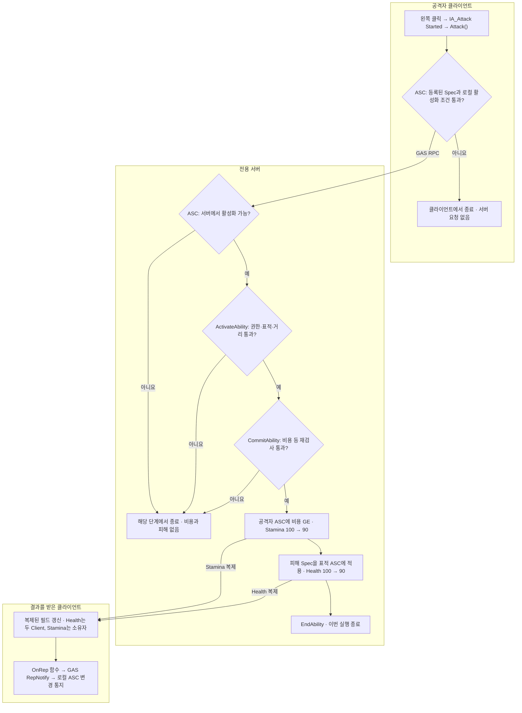

# CoopRPG의 GAS 단타 구현 읽기

CoopRPG · 2026-11-15 · UE 5.8.4 · V02 학습·구현 기록

왼쪽 클릭 한 번으로 전용 서버가 공격을 판단하고, 공격자의 스태미나와 표적의 체력을 바꾸는 경로를 읽는다. **GA는 언제 실행할지, GE는 어떤 규칙으로 값을 바꿀지, AttributeSet은 값을 어떻게 저장하고 복제할지 맡는다.** ASC는 그 사이에서 능력 등록·실행 요청·효과 적용·속성 변경 통지를 연결한다.

[1. 한 번의 클릭](#attack-flow) · [2. GA 초기화와 수명](#ability-lifecycle) · [3. 확인·소모·피해](#attack-checks) · [4. GE와 Modifier](#effect-definition) · [5. AttributeSet과 복제](#attribute-replication) · [6. 확인 범위](#verification-scope)

범위는 **현재 고정 표적 단타**다. 프로젝트에서 실제 사용하는 코드를 중심으로 다루며, 무기 장착·쿨다운·버프·피격 취소는 비교가 필요한 곳에서만 언급한다.

<a id="attack-flow"></a>
## 1. 왼쪽 클릭에서 체력 90까지



그림을 표시하지 않는 뷰어에서는 다음 순서로 읽으면 된다. **입력 → ASC의 로컬 확인·서버 요청 → 서버의 활성화 확인 → 표적·거리 판단 → 비용 확정 → 피해 GE 적용 → 속성 복제와 로컬 변경 통지.** 복제 화살표는 변경값의 전달을 뜻하며 두 속성의 도착 순서를 보장하지 않는다.

**근거** · [입력·ASC 호출](../../Game/Source/CoopRPG/Character/CoopRPGCharacter.cpp) · [서버 단타](../../Game/Source/CoopRPG/AbilitySystem/Abilities/CoopRPGMeleeAbility.cpp) · [속성 복제 코드](../../Game/Source/CoopRPG/AbilitySystem/Attributes/CoopRPGCombatAttributes.cpp) · [두 클라이언트 시험](../Validation/Index.md#v02-attack-input-regression)

<a id="ability-lifecycle"></a>
## 2. GA는 어떻게 준비되고 다시 쓸 수 있는가

### 클래스 설정, ActorInfo, 능력 부여는 서로 다른 단계다

| 단계                   | 현재 CoopRPG                                                                                                                            | 여기서 정하는 것                                                                                                                      |
| -------------------- | ------------------------------------------------------------------------------------------------------------------------------------- | ------------------------------------------------------------------------------------------------------------------------------ |
| GA 클래스 기본값           | 생성자에서 `InstancedPerActor`, `ServerOnly`, `CostGameplayEffectClass = UCoopRPGMeleeCost::StaticClass()`                                 | ASC에 부여된 능력이 실행 간 인스턴스를 재사용할 수 있게 한다. 능력 본체는 서버에서만 실행한다. 기본 비용 GE도 지정한다. 이 시점에 능력이 특정 캐릭터에게 부여되거나 비용이 차감되지는 않는다.               |
| ASC와 AttributeSet 준비 | 캐릭터와 표적 생성자에서 두 객체를 기본 서브오브젝트로 만든다. 둘 다 복제 ASC에 `Minimal`을 설정한다.                                                                      | 객체를 준비한다. `Minimal`은 활성 GE의 복제 정책이고, Health·Stamina의 수신 범위는 각 프로퍼티의 복제 조건이 정한다.                                                |
| ActorInfo 초기화        | 양쪽 Actor의 `BeginPlay`에서 `InitAbilityActorInfo(this, this)`. 캐릭터는 `NotifyControllerChanged`에서도 갱신한다.                                   | ASC가 누구의 것인지(`OwnerActor`), 누구를 통해 실행하는지(`AvatarActor`) 연결한다. 여기서는 둘 다 같은 Actor다.                                              |
| 서버에서 GA 부여           | 캐릭터 `BeginPlay`의 `HasAuthority()` 분기에서 `GiveAbility(FGameplayAbilitySpec(UCoopRPGMeleeAbility::StaticClass()))`. 표적에는 이 GA를 부여하지 않는다. | ASC의 사용 가능 목록에 등록한다. 현재 Spec 기본값은 레벨 1, `InputID = INDEX_NONE`, `SourceObject = nullptr`다. 입력은 Enhanced Input에서 클래스 기준으로 요청한다. |
| 이번 실행과 종료            | `TryActivateAbilityByClass` → `ActivateAbility` → `EndAbility`                                                                        | 클릭마다 등록된 능력을 찾아 이번 실행을 시도한다. `EndAbility`는 이 실행을 닫으며 기존 등록은 다음 클릭에도 남는다.                                                       |

예를 들어 무기로 능력을 제공하는 구조에서는 **장착할 때 서버가 부여하고, 해제할 때 저장한 Handle로 제거**할 수 있다. 캐릭터의 기본 능력으로 계속 부여하고 장착 여부만 판정하는 방식도 가능하다. 어느 쪽을 쓸지는 장착에 따라 **능력 목록 자체가 달라지는지**로 판단한다. 현재 단타에는 장착 판정과 장착별 부여·제거가 없다.

AttributeSet을 ASC에 연결하는 것과 ActorInfo 초기화도 별개다. 엔진은 ASC 초기화 시 소유 Actor의 서브오브젝트에서 AttributeSet을 찾아 등록한다. CoopRPG는 두 Actor의 생성자에 AttributeSet을 만들어 두므로 별도의 수동 등록을 하지 않는다. `NotifyControllerChanged`는 ActorInfo만 갱신하고 능력을 다시 부여하지 않는다.

**근거** · [캐릭터의 초기화와 부여](../../Game/Source/CoopRPG/Character/CoopRPGCharacter.cpp) · [표적의 초기화](../../Game/Source/CoopRPG/Combat/CoopRPGAttackTarget.cpp) · [GA 생성자](../../Game/Source/CoopRPG/AbilitySystem/Abilities/CoopRPGMeleeAbility.cpp) · [Epic의 능력 수명](https://dev.epicgames.com/documentation/en-us/unreal-engine/using-gameplay-abilities-in-unreal-engine)

### 자주 읽게 되는 함수

| 함수 | 누가 호출하며 무엇을 하는가 |
|---|---|
| `GiveAbility(Spec)` / `ClearAbility(Handle)` | 서버가 ASC 목록에 등록하거나 제거한다. 제거 시점에 실행 중이면 종료 뒤 제거하는 `SetRemoveAbilityOnEnd`도 선택할 수 있다. 현재 단타에는 개별 능력 제거 코드가 없다. |
| `OnGiveAbility` / `OnRemoveAbility` | 능력 부여·제거와 관련된 엔진 확장 지점이다. CoopRPG가 재정의한 함수는 아니다. |
| `TryActivateAbilityByClass(Class, bAllowRemoteActivation)` | ASC에서 등록된 클래스를 찾고 Handle로 활성화를 시도한다. 기본 인수 `true`는 필요한 경우 원격 활성화 요청을 허용한다. 클라이언트 호출이 `true`를 반환해도 이번 공격의 피해가 승인됐다는 뜻은 아니다. |
| `CanActivateAbility(...)` | 실행 전 사전 확인이다. 기본 구현은 역할, 태그, 비용과 쿨다운 등을 본다. 현재 GA는 기본 구현을 사용한다. |
| `IsActive()` | 능력이 현재 실행 중인지 조회한다. 사용 가능 여부를 검사하는 `CanActivateAbility`와 목적이 다르다. |
| `ActivateAbility(...)` | 활성화 조건을 통과하면 실행되는 본체다. CoopRPG가 직접 재정의해 서버 표적·거리 판단부터 피해 적용까지 처리한다. |
| `CommitAbility(...)` | 사용을 확정할 시점에 비용·쿨다운을 다시 확인하고 설정된 GE를 공격자에게 적용한다. 현재 단타는 비용 GE만 설정돼 있다. |
| `EndAbility(...)` / `CancelAbility(...)` | `EndAbility`는 현재 실행을 정리한다. `CancelAbility`는 취소 가능 여부를 확인하고 실행을 중단하는 경로다. 이 단타는 별도 취소 절차를 구현하지 않았으며, 실패 분기에서 직접 `EndAbility`를 호출한다. |

### `ActivateAbility`의 매개변수 네 개

| 매개변수 | 코드에서 읽는 법 |
|---|---|
| `FGameplayAbilitySpecHandle Handle` | **어떤 등록 항목인가.** ASC가 부여한 `FGameplayAbilitySpec`을 찾는 식별자다. 클릭마다 새로 부여되는 번호가 아니다. |
| `const FGameplayAbilityActorInfo* ActorInfo` | **누가 실행하는가.** Owner·Avatar와 ASC 등이 들어 있다. 현재 구현은 `AvatarActor`를 공격 Pawn으로, `AbilitySystemComponent`를 공격자 ASC로 사용한다. |
| `FGameplayAbilityActivationInfo ActivationInfo` | **이번 실행이 어떤 상태인가.** 실행 모드와 예측 키 등 활성화 정보를 담는다. 현재 코드는 받아서 `CommitAbility`와 `EndAbility`에 전달하며 클라이언트 피해 예측은 하지 않는다. |
| `const FGameplayEventData* TriggerEventData` | **어떤 게임플레이 이벤트가 실행을 시작했는가.** 이벤트로 시작한 경우 발신자·대상·태그 등의 전달 데이터를 담을 수 있다. 현재 클릭은 이벤트 페이로드 없이 클래스로 활성화하며 본체에서 이 인수를 쓰지 않는다. |

`CanActivateAbility`에는 `Handle`, `ActorInfo` 외에 선택적인 출발·대상 태그와 실패 이유를 담을 출력 태그가 있다. 기본 태그 확인이 표적을 검색하거나 사거리를 재는 것은 아니다. `CommitAbility`는 `Handle`, `ActorInfo`, `ActivationInfo`와 선택적 실패 태그 출력을 받는다. `EndAbility` 뒤의 두 bool은 종료를 네트워크로 전파할지(`bReplicateEndAbility`), 취소로 정리할지(`bWasCancelled`)다. 현재 코드는 정상에 `false, false`, 본체의 거절 경로에 `false, true`를 전달한다.

**근거** · [실제 GA 선언](../../Game/Source/CoopRPG/AbilitySystem/Abilities/CoopRPGMeleeAbility.h) · [실행·종료 호출부](../../Game/Source/CoopRPG/AbilitySystem/Abilities/CoopRPGMeleeAbility.cpp) · [Epic의 GA API](https://dev.epicgames.com/documentation/unreal-engine/API/Plugins/GameplayAbilities/UGameplayAbility?application_version=5.8)

<a id="attack-checks"></a>
## 3. 어디서 거절하고 언제 스태미나를 차감하는가

| 시점 | 검사와 처리 | 실패하면 |
|---|---|---|
| 소유 클라이언트의 ASC | 등록된 Spec을 찾아 `CanActivateAbility`로 로컬 상태를 검사한다. 현재 `ServerOnly` 정책에서도 통과한 경우에만 GAS가 서버로 활성화 요청을 보낸다. | 요청을 보내지 않는다. 서버 로그에 거리 거절이 뜨지 않는다. |
| 서버 ASC | 수신한 Handle과 정책 등을 확인하고 서버 상태로 `CanActivateAbility`를 검사한다. 비용 검사도 여기서 실행될 수 있다. | `ActivateAbility` 본체에 들어가지 않는다. `AttackRejected ... CommitFailed`는 본체 안의 별도 로그다. |
| 서버 GA 본체 | 유효한 공격 Pawn·권한·공격자 ASC를 확인한다. 서버의 GameMode에서 고정 표적을 찾고 유효성 및 `Health > 0`을 확인한다. 서버 좌표의 **수평 거리**(`Dist2D`)가 250cm를 넘으면 거절한다. | 거리 실패는 `Reason=OutOfRange`, 표적 실패는 `Reason=InvalidTarget`으로 기록하고 확정 전에 종료한다. |
| `CommitAbility` | 비용과 설정된 쿨다운을 재검사한다. 현재 비용은 **스태미나 10**이다. 기본 `CheckCost`는 Additive 비용에 대해 `CurrentValue + CostValue < 0`인지 본다. 스태미나 9는 실패하고 정확히 10은 통과해 0이 될 수 있다. | 본체에서 재검사가 실패한 경우 `Reason=CommitFailed`. 이 분기에서 피해 GE를 만들거나 적용하지 않는다. |
| Commit 성공 뒤 | 공격자의 스태미나를 깎는 비용 GE는 Commit 과정에서 적용된다. 그 뒤 GA가 피해 Spec을 만들어 **표적 ASC**에 적용한다. | Commit은 공격 사용의 확정 지점이다. 피해 효과가 나중에 거절되더라도 비용을 자동으로 되돌리는 트랜잭션은 아니다. |

현재 사거리는 두 Actor 원점 사이 수평 거리다. 고도 차이, 장애물, 공격 방향, 무기 충돌, 무기 장착은 검사하지 않는다. 쿨다운도 아직 설정되지 않았다. 기본 GAS 방식으로 추가한다면 지속 시간과 차단 태그를 부여하는 쿨다운 GE를 지정한 다음, 태그의 보유와 만료를 시험할 수 있다.

**근거** · [서버의 표적·거리·Commit 구현](../../Game/Source/CoopRPG/AbilitySystem/Abilities/CoopRPGMeleeAbility.cpp) · [UE 5.8.4 활성화·비용 소스 위치](#engine-source) · [Epic의 활성화 및 비용·쿨다운 설명](https://dev.epicgames.com/documentation/en-us/unreal-engine/using-gameplay-abilities-in-unreal-engine)

<a id="effect-definition"></a>
## 4. GE는 어떻게 구성하고 누구에게 적용하는가

**GE 클래스는 효과의 정의, `FGameplayEffectSpec`은 이번에 적용할 효과의 실행 데이터**다. Spec에는 GE 정의의 참조, 레벨, 효과 컨텍스트, 평가된 Modifier 값 등이 들어간다. 컨텍스트에는 효과를 일으킨 주체 정보 등이 담길 수 있다. 표적 ASC는 아래 호출에서 별도로 전달한다.

| GE 구성 항목 | 의미 | 비용 GE | 피해 GE |
|---|---|---|---|
| `DurationPolicy` | 즉시 실행, 시간 제한, 무기한 중 효과 수명을 정한다. | `Instant` | `Instant` |
| `Modifiers` | 어떤 속성을 어떻게 바꿀지 지정하는 목록이다. | 스태미나 Modifier 1개 | 체력 Modifier 1개 |
| `Attribute` | 바꿀 속성의 식별자. Modifier 1개의 대상 필드다. | `GetStaminaAttribute()` | `GetHealthAttribute()` |
| `ModifierOp` | 기존 값과 계산한 크기를 어떻게 합칠지 정한다. | `Additive` | `Additive` |
| `ModifierMagnitude` | 연산에 쓸 크기와 계산 방식이다. | `FScalableFloat(-10.0f)` | `FScalableFloat(-10.0f)` |

`FGameplayModifierInfo`에는 평가 채널 설정과 소스·대상 태그 조건도 있다. 현재 두 Modifier에는 별도 설정이 없다. 이 예에서 핵심은 **대상 속성·연산·크기** 세 가지다. 효과 종류를 늘릴 때는 정의의 기간과, 태그로 효과 적용 자체를 제한할지 Modifier 평가를 제한할지도 따로 결정한다.

지금은 레벨에 따른 커브를 연결하지 않아 두 크기가 모두 고정 `-10`이다. `Additive`이므로 기존 값에 `-10`을 더한다. 비용과 피해를 두 GE로 나눈 이유는 **수신 ASC와 적용 책임이 다르기 때문**이다. 비용은 공격자가 내고, 피해는 표적이 받는다. 같은 형식의 GE라도 공격자에게 적용할지 표적에게 적용할지는 호출 경로에서 결정한다.

```cpp
const FGameplayEffectSpecHandle Damage = MakeOutgoingGameplayEffectSpec(UCoopRPGMeleeDamage::StaticClass());
check(Damage.IsValid());
Source->ApplyGameplayEffectSpecToTarget(*Damage.Data.Get(), Target->GetAbilitySystemComponent());
```

위 C++ 코드는 서버 GA의 피해 적용 부분이다. 여기서 두 ASC의 역할이 드러난다. `Source`가 적용을 요청하고, 두 번째 인수인 표적 ASC의 AttributeSet에서 `Health`가 바뀐다. 이 프로젝트에서는 C++ 생성자로 두 GE를 정의했으며, 같은 종류의 설정은 데이터 전용 GE Blueprint로도 구성할 수 있다.

**근거** · [피해와 비용 GE 정의](../../Game/Source/CoopRPG/AbilitySystem/Effects/CoopRPGMeleeEffects.cpp) · [피해 Spec 생성·적용](../../Game/Source/CoopRPG/AbilitySystem/Abilities/CoopRPGMeleeAbility.cpp) · [Epic의 GE 구성](https://dev.epicgames.com/documentation/en-us/unreal-engine/gameplay-effects-for-the-gameplay-ability-system-in-unreal-engine) · [Modifier API](https://dev.epicgames.com/documentation/en-us/unreal-engine/API/Plugins/GameplayAbilities/FGameplayModifierInfo)

<a id="attribute-replication"></a>
## 5. AttributeSet의 매크로·재정의·복제 연결

`UCoopRPGCombatAttributes`는 `UCLASS()`와 `GENERATED_BODY()`로 언리얼 리플렉션을 사용하는 클래스다. `UPROPERTY`는 속성 필드를, `UFUNCTION()`은 복제 시 엔진이 부를 콜백을 리플렉션에 노출한다. GAS 전용 접근자 매크로는 그 위에 별도로 쓰는 C++ 편의 코드다.

`UCoopRPGCombatAttributes` 안에 `FGameplayAttributeData Health`와 `Stamina`가 있다. 각각 `BaseValue`와 `CurrentValue`를 가지며 생성자의 `Health(100.0f), Stamina(100.0f)`가 두 값의 시작점을 100으로 잡는다. 현재 즉시 GE처럼 다른 보정이 없는 예에서 100에 `-10`을 적용하면 Base와 Current가 모두 90이 된다.

### 어떤 매크로가 어떤 함수를 만드는가

| 헤더·구현에 쓴 매크로 | 생기는 함수 또는 수행하는 일 | 현재 어디서 쓰는가 |
|---|---|---|
| `GAMEPLAYATTRIBUTE_PROPERTY_GETTER(UCoopRPGCombatAttributes, Health)` | `static FGameplayAttribute GetHealthAttribute()`를 만든다. 반사 프로퍼티로부터 **어떤 속성인지** 식별한다. | GE의 대상 속성 지정, `PreAttributeBaseChange`에서 속성 비교 등에 쓴다. `GetStaminaAttribute()`도 같은 방식이다. |
| `GAMEPLAYATTRIBUTE_VALUE_GETTER(Health)` | `float GetHealth() const`를 만든다. 해당 객체의 **현재 숫자**(`CurrentValue`)를 읽는다. | AttributeSet의 `OnRep_Health` 로그와 표적 Actor의 `GetHealth()` 위임에서 사용한다. `GetStamina()`도 같은 방식이다. |
| `GAMEPLAYATTRIBUTE_REPNOTIFY(Class, Health, PreviousHealth)` | 함수를 선언하지 않는다. 이미 작성된 `OnRep_Health` 안에서 실행돼 새 값과 옛 값을 로컬 ASC의 `SetBaseAttributeValueFromReplication`에 넘긴다. | 복제된 프로퍼티 변경을 GAS의 계산·알림 경로에 연결한다. 스태미나에도 동일하게 사용한다. |
| `DOREPLIFETIME_CONDITION_NOTIFY(...)` | 복제 목록에 필드와 수신 조건·통지 정책을 등록한다. | 프로젝트가 재정의한 `GetLifetimeReplicatedProps` 안에서 Health·Stamina를 각각 등록한다. |

`GAMEPLAYATTRIBUTE_VALUE_SETTER`와 `GAMEPLAYATTRIBUTE_VALUE_INITTER`는 이 클래스에서 쓰지 않는다. 따라서 `SetHealth`, `InitHealth` 및 스태미나 쪽 대응 함수는 이 선언에서 자동으로 생기지 않는다. 엔진의 setter 매크로는 ASC를 통해 Base 값을 설정하고, initter 매크로는 필드의 Base·Current를 초기화한다. 현재 코드는 초기값을 생성자에서, 전투 중 변경을 GE에서 처리한다.

### 어떤 선언이 어떤 콜백과 이어지는가

| 연결 | Health | Stamina |
|---|---|---|
| `UPROPERTY(ReplicatedUsing = ...)` | `OnRep_Health`를 이 필드의 복제 콜백으로 지정 | `OnRep_Stamina` 지정 |
| 복제 조건·통지 | `COND_None` · `REPNOTIFY_Always`. 표적이 복제되는 두 클라이언트 모두 받는다. | `COND_OwnerOnly` · `REPNOTIFY_Always`. 해당 Pawn의 소유 클라이언트만 받는다. |
| 개발자가 작성한 `UFUNCTION()` | `OnRep_Health(const FGameplayAttributeData& PreviousHealth)` | `OnRep_Stamina(const FGameplayAttributeData& PreviousStamina)` |

`REPNOTIFY_Always`는 **프로퍼티를 복제로 수신했을 때** 같아 보이는 값에도 RepNotify를 실행하는 조건이다. 값을 매 프레임 보내는 설정은 아니다. 위 OnRep 두 개는 개발자가 직접 작성한 콜백이다. 이 클래스에서 엔진 가상 함수를 재정의한 것은 **`GetLifetimeReplicatedProps`와 `PreAttributeBaseChange`**다. `PreAttributeBaseChange`는 Base 값이 바뀌기 전에 참조 인수 `NewValue`를 0~100으로 제한한다. 효과 적용을 승인하거나 죽음을 처리하는 함수는 아니며, 지속 버프로 계산한 모든 Current 값의 상한을 보장하지도 않는다. `PreAttributeChange`, `PreGameplayEffectExecute`, `PostGameplayEffectExecute`는 현재 클래스에서 재정의하지 않았다.

### Health 100 → 90에서 RepNotify가 필요한 이유

1. 서버의 즉시 피해 GE가 표적 AttributeSet의 값을 바꾸고, 언리얼 복제가 클라이언트의 `Health` 필드에 90을 쓴다.
2. 클라이언트에서 `OnRep_Health`가 호출된다. `PreviousHealth.GetCurrentValue()`는 100이고, 이 사례의 `GetHealth()`는 콜백 시작부터 이미 90이다.
3. 콜백 안의 `GAMEPLAYATTRIBUTE_REPNOTIFY`가 같은 클라이언트의 ASC에 새 값·옛 값을 연결한다. 해당 속성의 Aggregator가 없으면 등록된 속성 변경 델리게이트로 이전·현재 값을 알린다. Aggregator가 있으면 서버 Base를 계산기에 맞추고 해당 클라이언트의 적용 가능한 보정으로 다시 평가한다.
4. 따라서 이 단순 경로에서 매크로를 빼도 콜백이 직접 읽는 `GetHealth()` 값과 로그는 90일 수 있다. 하지만 ASC의 `GetGameplayAttributeValueChangeDelegate`에만 구독한 체력바는 그 복제 이벤트의 알림을 받지 못한다. 현재 체력바는 미구현이며 이는 엔진 코드에서 읽은 결과다. 이 호출로 서버에 수신 확인을 보내지는 않는다.

**근거** · [AttributeSet 선언](../../Game/Source/CoopRPG/AbilitySystem/Attributes/CoopRPGCombatAttributes.h) · [초기값·복제 등록·OnRep·범위 제한](../../Game/Source/CoopRPG/AbilitySystem/Attributes/CoopRPGCombatAttributes.cpp) · [표적의 getter 위임](../../Game/Source/CoopRPG/Combat/CoopRPGAttackTarget.cpp) · [UE 5.8.4 매크로·복제 소스 위치](#engine-source) · [Epic의 AttributeSet 복제 예시](https://dev.epicgames.com/documentation/en-us/unreal-engine/gameplay-attributes-and-attribute-sets-for-the-gameplay-ability-system-in-unreal-engine)

<a id="verification-scope"></a>
## 6. 무엇을 실제로 확인했는가

기존 전용 서버·독립 Client 2개 시험에서 **공격 클릭 4회 → 서버 요청 4회**를 관찰했다. 거리 밖 두 요청은 피해와 비용 없이 거절됐다. 거리 안 두 요청에서 양쪽 표적 체력은 100→90→80, 각 요청자의 스태미나는 자신의 클라이언트에서 100→90이었다. 이번 문서에서는 해당 시험 기록과 코드·엔진 구현을 대조했다.

비용 부족은 **로컬에서 요청 없이 차단하는 경우**와 **서버가 수신한 뒤 차단하는 경우**를 분리해서 보아야 한다. 후속 시험에서는 클라이언트 요청 로그, 서버 수신·활성화 실패 로그, 서버의 HP·스태미나 전후를 함께 대조하는 편이 좋다. 위의 스태미나 9/10 경계는 코드에서 도출한 기대값이다. 쿨다운은 아직 설정이 없고 무효 표적·피격 취소·패킷 지연·손실도 이번 문서의 신규 실행 검증 범위가 아니다.

**근거** · [V02 고정 표적 첫 시험](../Validation/Index.md#v02-basic-attack) · [입력 통합 이후 회귀](../Validation/Index.md#v02-attack-input-regression) · [다음 검증 카드](../Roadmap.md#next-work)

<a id="engine-source"></a>
## 근거 및 더 읽기

직접 대조한 엔진 코드의 경로는 UE 5.8.4 설치 트리의 `Engine/Plugins/Runtime/GameplayAbilities/Source/GameplayAbilities/`를 기준으로 한다. 장비마다 설치 위치가 달라질 수 있어 파일 이름과 검색할 심볼을 함께 적는다.

| 파일 | 찾아볼 심볼과 판단 |
|---|---|
| `Public/AttributeSet.h` · `Private/GameplayEffect.cpp` | `GAMEPLAYATTRIBUTE_REPNOTIFY`와 `SetBaseAttributeValueFromReplication`에서 매크로 확장 및 Aggregator 유무에 따른 통지 경로를 확인할 수 있다. |
| `Private/AbilitySystemComponent_Abilities.cpp` | `InitializeComponent`의 AttributeSet 자동 등록과 `TryActivateAbilityByClass`, `TryActivateAbility`, `InternalServerTryActivateAbility`의 활성화 경로를 볼 수 있다. |
| `Private/Abilities/GameplayAbility.cpp` · `Private/GameplayEffect.cpp` | `CanActivateAbility`, `CommitCheck`, `CommitExecute`, `CanApplyAttributeModifiers`에서 비용의 사전 검사·재검사·적용을 나눠 볼 수 있다. |

- [CoopRPG의 서버 권한과 ASC 배치](../Architecture.md#server-authority)는 왜 캐릭터 수명에 ASC를 맞췄는지 설명한다.
- [Epic의 Gameplay Ability 안내](https://dev.epicgames.com/documentation/en-us/unreal-engine/using-gameplay-abilities-in-unreal-engine)와 [Gameplay Effect 안내](https://dev.epicgames.com/documentation/en-us/unreal-engine/gameplay-effects-for-the-gameplay-ability-system-in-unreal-engine)는 기본 수명과 효과 구성의 선택지를 설명한다.
- [Epic의 Lyra 능력 구성](https://dev.epicgames.com/documentation/en-us/unreal-engine/abilities-in-lyra-in-unreal-engine)은 장착 시 능력 부여와 PlayerState에 ASC를 두는 실전 예시다.
