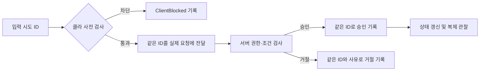

# CoopRPG 검증 로그 도구

CoopRPG · 2026-11-15 · 병렬 보기·캡처·Excel 저장 안내

게임을 조작하면서 입력·서버 판정·속성 복제를 한 화면에서 확인하는 읽기 전용 도구다. 게임 두 창과 로그 창을 서로 다른 모니터에 배치하고, 같은 기록을 통합·프로세스별로 보거나 2~4칸에서 나란히 비교한다. 요청 ID 전달·패킷 분석은 이번 구현에 포함하지 않는다.

**색인** · [검증 환경 선택](#choose-environment) · [실행과 배치](#launch) · [화면 읽기](#reading) · [병렬 비교](#parallel) · [캡처·Excel 저장](#export) · [접속 흐름 Before / After](#connection-before-after) · [GAS 호출 Before / After](#gas-rpc-before-after) · [상세창 Before / After](#detail-before-after) · [요청자와 Actor 역할](#player-attribution) · [로그 표시 규칙](#logging-contract) · [요청 ID 설계](#request-design) · [검증과 한계](#verification)

<a id="choose-environment"></a>
## 검증 환경 선택

질문에 맞춰 실행 범위를 고르면 같은 현상을 반복 확인하면서 빌드 시간을 줄일 수 있다. CoopRPG는 게임 로직을 바꿀 때 PIE로 빠르게 확인하고, 실행 가능한 빌드의 재현은 패키지로 검증하며, 로그 도구만 바꿀 때는 기존 실행 로그를 재생하는 것을 기본으로 권한다.

| 환경 | 사용할 때 | 선택 이유 |
|---|---|---|
| PIE | 구현 중 입력·빙의·서버 판정·속성 복제를 빠르게 확인할 때 | 에디터 출력 로그와 디버거를 함께 쓸 수 있다. `Play As Client`로 전용 서버 월드와 클라이언트 두 개를 구성한다. 프로세스 간 차이를 좁힐 때는 `Run Under One Process`를 끈다. |
| 패키지 실행 | 쿠킹된 게임을 전용 서버와 클라이언트로 기동하거나, 신규 접속·입력·판정 로그를 수집할 때 | 실제 `CoopRPGServer.exe`와 `CoopRPGClient.exe`의 시작·접속·종료 및 콘텐츠를 확인한다. 런처가 두 클라이언트를 같은 서버에 연결하고 프로세스별 로그를 모아 새 실행을 반복할 수 있다. 현재 수동 실행은 같은 PC의 루프백이며 개발용 입력 모드를 쓴다. |
| 기존 로그 재생 | 표시명·필터·시각순·캡처·XLSX 또는 Before/After를 확인할 때 | 한 번 수집한 `server.log`, `a.log`, `b.log`를 그대로 사용해 뷰어의 표시 차이를 비교할 수 있다. 게임 세션을 실행하지 않고 로그만 연다. |

PIE는 에디터가 실제로 읽은 코드와 콘텐츠를 확인한다. 비용·쿨다운 작업 당시에는 Editor 갱신을 보류했으므로 그 기능의 수동 재현 기준은 아래 Win64 Development 패키지다. 뷰어는 세 프로세스의 관측을 비교하고 근거를 저장할 때 함께 사용한다. [CoopRPG 비용·쿨다운 검증](Index.md#v02-cost-cooldown) · [Epic PIE 멀티플레이](https://dev.epicgames.com/documentation/unreal-engine/play-in-editor-multiplayer-options-in-unreal-engine?lang=en-US) · [Epic 전용 서버 빌드·쿠킹](https://dev.epicgames.com/documentation/unreal-engine/setting-up-dedicated-servers-in-unreal-engine?lang=en-US)

<a id="launch"></a>
## 실행과 배치

아래 명령은 Windows PowerShell에서 직접 실행한다. `Bypass`는 해당 PowerShell 프로세스에 적용한다.

### PIE에서 실행

PowerShell에서 소스 에디터와 프로젝트를 연다. `L_Movement`를 열고 Play 설정에서 `New Editor Window (PIE)`, `Play As Client`, 플레이어 수 `2`를 선택한 뒤 Play를 누른다. 출력 로그에서 확인할 `LogCoopRPG*` 카테고리를 검색한다.

```powershell
& 'C:/UE/5.8.4/Engine/Binaries/Win64/UnrealEditor.exe' 'C:/CoopRPG/Game/CoopRPG.uproject'
```

**근거** · [PIE 설정과 확인 범위](Index.md#에디터에서-먼저-확인하기)

### 패키지 실행과 모니터 배치

다음 명령은 저장된 모니터 설정을 사용해 전용 서버 1개를 백그라운드에서 시작하고, 같은 로컬 포트에 접속하는 클라이언트 2개와 라이브 로그 뷰어를 띄운다. PowerShell에 새 실행 로그 폴더와 해당 서버 PID가 표시된다. `-NoForeground`는 런처가 마지막에 클라이언트 포커스를 요청하는 동작을 생략한다.

```powershell
powershell.exe -NoProfile -ExecutionPolicy Bypass -File "C:/CoopRPG/Tools/Validation/Start-CombatManual.ps1" -PackageRoot "C:/CoopRPG/Artifacts/Validation/v02-manual-input-20261115-172824/final/Stage" -NoForeground
```

종료할 때는 클라이언트 두 창과 로그 뷰어를 닫은 뒤, 출력된 `Stop-Process -Id <이번 서버 PID>`를 실행한다. 모니터를 명시하려면 먼저 아래 목록을 확인한다.

```powershell
powershell.exe -NoProfile -ExecutionPolicy Bypass -File "C:/CoopRPG/Tools/Validation/Start-CombatManual.ps1" -ListMonitors
```

이번 장비에서는 목록의 1번이 오른쪽 화면, 2번이 왼쪽 주 화면이었다. 1차 검증 당시 작업 영역은 각각 2560×1392였고, 병렬 보기 검증 때 재조회한 작업 영역은 각각 1920×1032였다. 해상도·배율·연결 상태에 따라 목록을 다시 확인하며, 번호는 Windows 설정의 표시 번호와 같다고 가정하지 않는다. 아래 예시에서는 오른쪽에 게임 두 창을 열고 왼쪽에 로그 창을 최대화한다.

```powershell
powershell.exe -NoProfile -ExecutionPolicy Bypass -File "C:/CoopRPG/Tools/Validation/Start-CombatManual.ps1" -PackageRoot "C:/CoopRPG/Artifacts/Validation/v02-manual-input-20261115-172824/final/Stage" -GameMonitor 1 -LogMonitor 2 -AlwaysOnTop
```

| 선택 | 동작 |
|---|---|
| `-GameMonitor`, `-LogMonitor` | 목록 번호 또는 DeviceName 지정. 생략 시 저장한 선택을 사용하고, 유효하지 않으면 현재 사용할 수 있는 화면으로 복구 |
| 서로 다른 화면 | 게임 화면에 두 클라이언트, 로그 화면에 최대화한 뷰어 |
| 같은 화면 또는 한 모니터 | 게임을 위에, 로그를 아래에 배치. 상세는 접은 상태로 시작 |
| `-AlwaysOnTop` | 게임과 로그 창을 항상 위에 표시. 키보드 포커스 고정과는 다름 |
| `-NoLogViewer` | 게임 두 창만 실행 |
| 로그 창의 `화면`에서 모니터 선택 → `이동` | 실행 중 로그 창만 이동. 게임 창 배치는 바꾸지 않음 |

모니터·글자 크기·단일/병렬 보기·분할 수·표시 모드·각 칸의 출처 선택은 Git 제외 경로 `Artifacts/Validation/viewer-settings.json`에 저장한다. 저장 직전 값은 `.previous`에 보존한다. 다른 프로젝트·OS 설정은 바꾸지 않는다. 정렬은 시작할 때 항상 **시각순**이며 수집순은 실행 중에 선택한다. 처음에는 단일 보기이고, 이후 저장된 보기 설정을 사용한다. 화면 연결 변경은 다음 실행 또는 `화면` 묶음의 `이동` 버튼에서 다시 확인한다. 실행 중 연결 해제에 즉시 반응하는 기능은 없다.

### 기존 로그 재생과 로그 창 다시 열기

다음 명령은 Before/After에 사용한 보관 로그를 열어 표시명과 필터를 바로 비교한다. `카테고리 → 접속 흐름`을 선택하면 해당 실행의 접속 단계가 보인다. 캡처와 Excel은 같은 로그 폴더의 `Exports/`에 저장된다.

```powershell
powershell.exe -NoProfile -ExecutionPolicy Bypass -STA -File "C:/CoopRPG/Tools/Validation/Watch-CombatManual.ps1" -LogDirectory "C:/CoopRPG/Artifacts/Validation/v02-viewer-connection-20261115-205319/manual-20261115-184407-927" -ViewMode Parallel -PaneCount 3 -DisplayMode Aligned
```

로그 창을 닫아도 게임은 계속 실행된다. 위 명령의 `-LogDirectory` 값을 현재 런처가 출력한 실행 폴더로 바꾸면 실행 중인 게임의 로그 창만 다시 연다.

**근거** · [실행·배치 코드](../../Tools/Validation/Start-CombatManual.ps1) · [모니터·설정 처리](../../Tools/Validation/CombatViewerLayout.psm1) · [비용·쿨다운 재현과 종료 순서](Index.md#v02-cost-cooldown-manual)

<a id="reading"></a>
## 화면 읽기

**단일 보기**에서는 **통합** 탭에서 입력과 결과를 살피고, 해당 요청자의 **클라이언트 1/2** 탭 또는 **서버** 탭으로 좁힌다. `Client A/a.log`는 클라이언트 1, `Client B/b.log`는 클라이언트 2다. 탭은 실행 manifest의 sources 목록으로 만든다. 병렬 보기에서는 탭 대신 각 칸의 출처 목록을 사용한다. 클라이언트 수를 늘리는 런처 구현은 이번 범위 밖이다.

| 화면 | 읽는 기준 |
|---|---|
| 시각 | 로그의 UTC 날짜·시각을 보존하고 화면에는 PC의 현지 시각을 표시. 이번 장비는 KST |
| 관측 출처 | 로그를 쓴 프로세스. 그 프로세스가 관찰한 Actor의 소유자를 뜻하지 않음 |
| 단계·결과 | 접속 / 초기화 / 입력 / 요청 / RPC 호출 / 함수 반환 / 로컬 검사 / 서버 판정 / 복제 관찰을 구분. 제출은 서버 승인이 아님 |
| 사건·관측값 | 짧은 한국어 설명과 실제 수치. 거리·자원·남은 시간이 원문에 있을 때만 표시 |
| 검색·결과 필터 | 원문·설명·출처·행 식별자를 검색. 관찰, 승인, 거절, 호출, 제출, 미제출, 소비, 오류·경고, 미분류를 선택. 관찰에는 연결·입력·복제 등 여러 사건이 포함되므로 특정 사건은 검색도 함께 사용 |
| 카테고리 | 접속·초기화, 입력·요청, 서버 판정, 복제, 오류·경고, 상태·기타 중 여러 개 선택. `접속 흐름`, `공격 흐름`, `전체 선택`으로 자주 쓰는 조합을 바로 선택 |
| 선택 복사 / 경로 복사 | 마지막으로 조작한 칸의 선택 상세 / 현재 실행 로그 폴더를 복사 |
| 상세·원문 | 사건 요약, 행위자·기록 함수·역할, 이벤트, 추적 정보, 원문 순서로 표시. 서버 판정의 요청자와 행위자 역할은 미계측 |
| 일시정지 | 보이는 행과 필터 선택을 고정. 파일 읽기·게임 로그 기록은 계속되며 새 사건 수를 표시 |
| 최신 따라가기 / 최신으로 | 과거 행을 클릭·스크롤하면 따라가기를 해제. `최신으로`는 일시정지를 해제하고 마지막 행으로 이동 |
| 하단 상태 | 프로세스 실행/종료와 파일 대기/읽기 실패를 따로 표시. 마지막 사건 시각과 생략·대기 건수를 확인 |

`공격 흐름`은 `공격 입력 감지`, `GAS 서버 RPC 호출`, `GAS 활성화 함수 반환`, `비용 확정`, `취소 RPC 호출/수신`, `타격 확정`, `서버 거절`, `서버 취소 승인`, `피해 확정 실패`, `스태미나/체력 복제`를 모아 보여준다. `결과 → 취소` 또는 `빗나감`으로 좁힐 수 있다. [V03 수동 재현](Index.md#v03-attack-lifetime)을 참고한다. `결과 → 호출`은 GAS 활성화·취소 RPC 호출을, `결과 → 수신`은 서버 취소 RPC 수신을 보여준다. 수동 런처는 클라이언트와 서버에서 `LogCoopRPGInput Verbose`를 활성화한다. 서버 판정과 함수 반환은 각 프로세스가 기록한 시각에 표시되며, 함수 반환 행이 서버 판정 뒤에 나올 수 있다. 로컬 차단은 클라이언트에서 확인하고, 개별 요청 관계는 상세에서 미계측으로 표시한다.

색은 결과 열의 보조 표식이다. 승인은 초록, 거절은 주황, 오류는 붉은색, 경고는 노랑이며 항상 글자와 함께 표시한다. 사건 종류가 이미 알려져 있어도 원문의 Warning/Error/Fatal 수준을 요약 앞에 표시하고 색·오류 필터에 우선 반영한다. `포커스 클릭`은 창 전환 보호로 소비된 입력이다. 고장이나 서버 거절로 표시하지 않는다. `CommitFailed`는 원문에 추가 사유가 없으면 세부 원인 미확인으로 남긴다.

상단 첫 줄은 **검색 → 정렬 → 결과 │ 카테고리 │ 갱신 │ 상세·원문** 순서다. `갱신`에서 일시정지·최신 따라가기·최신으로를 조작한다. 둘째 줄에는 **보기·분할·비교, 화면, 복사, 저장**이 있다. `비교`에서 행 배치를 바꾸고 `화면`에서 모니터 이동·항상 위·글자 크기를 조작한다. 좁은 창에서는 그룹 단위로 다음 줄에 배치한다. 글자 크기 10~18pt는 표·상세·행 높이와 선택칸 너비에 함께 적용된다.

**근거** · [뷰어와 화면 동작](../../Tools/Validation/Watch-CombatManual.ps1) · [상단 배치 검증](Index.md#v02-viewer-toolbar-order)

카테고리 안에서 선택한 항목 중 하나에 해당하면 표시 후보가 된다. 검색·결과·출처도 설정했다면 해당 조건을 함께 적용한다. `오류·경고`는 다른 카테고리에 속한 사건의 Warning/Error/Fatal 수준도 포함한다. 기본은 전체 선택이며, 모두 해제하면 목록이 비워진다. 선택한 분류는 PNG 상태 JSON과 XLSX의 `내보내기 정보`에 기록한다.

창을 바꿀 때 기록하는 `창 전환 키 초기화`는 `상태·기타`에서 확인한다. W 상태가 원문에 있으면 전후 수치도 표시한다. `공격 흐름`에는 창 전환 직후 첫 클릭이 공격으로 전달되지 않은 이유를 보여주는 `포커스 클릭`이 포함된다.

<a id="parallel"></a>
## 병렬 비교

상단에서 **보기 → 병렬**, **분할 → 2·3·4**를 고른 뒤 **비교**에서 모아 보기 또는 공통 행 비교를 선택한다. 각 칸의 목록에서 통합·서버·클라이언트를 선택한다. 초기 세 칸은 서버·클라이언트 1·클라이언트 2이고, 네 번째는 통합이다. 단일 보기로 돌아가도 기존 출처 탭과 검색을 사용할 수 있다.

| 표시 모드 | 행 배치·이동 | 적합한 용도 |
|---|---|---|
| 모아 보기 | 각 칸의 출처에 해당하는 로그만 빈칸 없이 표시. 칸마다 독립 스크롤 | 특정 프로세스의 기록을 연속해서 읽기 |
| 공통 행 비교 | 검색·결과·정렬을 적용한 공통 목록의 같은 행을 모든 칸에 유지. 다른 출처의 행은 회색 바탕에 행 번호·시각만 표시. 세로 스크롤과 목록/상세 경계 높이를 함께 이동 | 여러 프로세스의 관측 순서를 나란히 비교 |

각 칸은 **위쪽 로그 목록 + 아래쪽 선택 상세**를 갖는다. 선택과 상세는 칸마다 독립적이며, 다른 칸에서 새 행을 선택해도 기존 상세는 유지된다. 공통 행 비교의 빈칸은 **다른 출처의 사건**을 뜻한다. 수신 실패·누락·미처리를 뜻하지 않는다. 통합 칸은 모든 행을 표시하고 요약 앞에 출처를 붙인다. 긴 요약은 생략 표시하며, 전체 수치·원문은 아래 상세와 가로 스크롤로 확인한다.

**시각순이 기본이다.** 공통 행은 같은 관측 사건을 배치한 것이며, 서로 다른 행을 같은 요청·패킷으로 연결한 것이 아니다. `행` 번호는 현재 검색·결과·정렬을 적용한 목록의 위치다. 필터 변경·늦게 도착한 기록·보관 한도 초과 때 바뀔 수 있으므로 고유 ID로 쓰지 않는다. 원문 재확인은 상세의 `EventId`와 파일 위치를 사용한다. 수집순 역시 파일을 읽은 순서이며 서버 처리 순서나 인과관계의 증거가 아니다.

검색·결과·정렬·일시정지·따라가기는 전체 칸에 적용한다. 어느 칸이든 과거 행을 조작하면 따라가기를 해제한다. 일시정지 중에는 필터·출처·보기 변경을 잠그고 수집만 계속한다. `최신으로`는 멈춤을 풀고 모든 칸을 갱신한다. 시각순에서 과거 시각의 로그가 늦게 추가되더라도 선택은 행 번호가 아닌 EventId로 유지한다. 선택한 기록이 필터나 전체 보관 한도 때문에 사라지면 상세를 비운다.

글자 12pt 기준 1920px 창에서는 네 칸, 1000×700 창에서는 두 칸 배치를 확인했다. 한 칸의 최소 폭은 440px이며 글자 크기에 비례해 늘어난다. 공간이 부족하면 바깥 스크롤로 나머지 칸·상세에 접근한다. 좁은 창에서 18pt와 다분할을 함께 쓰면 보이는 행이 적으므로 최대화하거나 분할 수를 줄인다. 같은 시각을 비교하려면 공통 행 비교를, 서로 다른 구간을 따로 읽으려면 모아 보기를 사용한다.

데이터는 **파일 읽기 → 한 번의 공통 필터·정렬 → 출처별 표시 행 → 각 목록·상세**로 흐른다. 칸마다 파일을 다시 읽지 않으며, 3,000건 보관 한도는 모든 칸이 공유한다. 공통 행 비교의 빈칸은 표시용 자리이며 실제 로그로 저장하거나 집계하지 않는다.

**근거** · [공통 목록과 화면](../../Tools/Validation/Watch-CombatManual.ps1) · [표시 행 구성](../../Tools/Validation/CombatLogViews.psm1) · [UI 검사](../../Tools/Validation/Test-CombatParallel.ps1) · [실측 결과·한계](Index.md#v02-viewer-parallel)

<a id="export"></a>
## 캡처·Excel 저장

상단 오른쪽의 **창 캡처**, **Excel 저장**, **저장 폴더**를 사용한다. 먼저 검색·결과·출처와 필요한 상세 행을 선택한다. 특정 순간을 남기려면 `일시정지`를 켠 뒤 저장한다. 저장 성공·실패와 경로는 하단에 나오며, 긴 경로는 하단에 마우스를 올려 확인한다.

| 버튼 | 저장 범위·결과 |
|---|---|
| 창 캡처 | 현재 창에 보이는 목록·선택 상세·분할 배치를 PNG로 저장. 같은 이름의 `.png.json`에 실행·필터·출처·선택 EventId·스크롤 위치·저장 시점을 함께 기록 |
| Excel 저장 | 현재 검색·결과·선택 출처에 해당하는 **목록 전체**를 실제 `.xlsx`로 저장. 화면 밖으로 스크롤된 행도 포함 |
| 저장 폴더 | 현재 실행 로그 폴더 아래 `Exports`를 탐색기로 열기. 첫 저장 전에는 비활성화 |

이름은 `CoopRPG-날짜-시각-고유값`으로 자동 생성한다. 기존 파일을 덮어쓰지 않으며 저장 결과는 현재 로그 폴더의 `Exports/`에 누적된다. 현재 런처의 로그 폴더는 Git 제외 경로다. 저장 위치를 바꾸는 대화상자는 이번 버전에 없으며, 필요한 파일을 저장 폴더에서 복사·이동한다. 로그 창을 다시 열어 새 버튼을 사용할 수 있고 게임 패키지 재빌드는 필요하지 않다.

### Excel에 포함되는 내용

`로그` 시트에는 행 번호·현지 시각·출처·단계·결과·요약·거절 사유, Actor/Target, UTC, Category/Level/EventCode, EventId, 수집순·파일 세대·바이트 위치, 원본 경로·원문·원문 필드와 요청 관계 상태를 남긴다. 첫 행과 식별 열을 고정하고 열별 필터를 제공한다. 원문이 길면 수식 입력줄이나 행 높이를 늘려 전체 텍스트를 읽는다. 날짜를 포함한 대조는 UTC 열을 사용한다.

`내보내기 정보` 시트에는 실행·저장 시점·검색·결과·정렬·보기·출처와 보관/생략 범위를 기록한다. 일시정지 중에는 **화면 데이터의 갱신 시점**과 **저장 당시의 수집 수**를 구분한다. 저장 중에는 뷰어의 읽기 타이머를 잠시 멈추고, 성공·실패 뒤 원래 상태로 복귀한다. 게임의 로그 기록은 계속된다.

단일 보기에서는 현재 출처 탭, 병렬 보기에서는 선택한 칸들의 출처 합집합을 내보낸다. 같은 출처를 여러 칸에 놓거나 통합 칸을 함께 표시해도 EventId당 한 번만 저장한다. 공통 행 비교의 회색 빈칸은 로그가 아니므로 제외한다. 행 번호는 현재 공통 목록의 위치를 유지해 출처를 좁히면 번호가 건너뛸 수 있다.

**범위:** Excel은 현재 뷰어가 표시하는 데이터의 사본이다. 원본 로그 파일 전체나 이미 보관 한도로 제거된 기록을 복구하지 않는다. PNG도 스크롤 밖 영역·다른 창을 포함하지 않으며, 운영체제 화면 전체 촬영 대신 이 WinForms 창을 자체 렌더링한다. 원문의 `=` 같은 문자는 수식으로 실행하지 않고 텍스트로 보존한다. Excel 셀의 길이 한도를 넘으면 잘라 저장하지 않고 실패 사유를 표시하며 원본 로그를 유지한다. Excel 프로그램 설치 없이 저장할 수 있다.

**근거** · [버튼·저장 시점](../../Tools/Validation/Watch-CombatManual.ps1) · [출처 합집합·PNG·데이터 구성](../../Tools/Validation/CombatLogExport.psm1) · [XLSX 기록](../../Tools/Validation/CombatWorkbookWriter.cs) · [실제 검증·한계](Index.md#v02-viewer-export)

<a id="connection-before-after"></a>
## 접속 흐름 Before / After

**발견** · 사용자는 클라이언트의 `접속 완료`가 서버보다 먼저 보이는 이유를 질문했다. 두 행의 원문을 대조해 클라이언트가 받은 `Welcomed by server`와 서버가 기록한 `Join succeeded`에 같은 표시명을 붙인 것이 원인임을 확인했다. 서버는 접속 사전 검사 뒤 Welcome을 보내고, 이후 클라이언트의 Join 요청을 받아 플레이어 입장을 처리한다. [기존 분류의 수정 위치](../../Tools/Validation/CombatLogReader.psm1) · [Epic의 접속 수명주기](https://dev.epicgames.com/documentation/en-us/unreal-engine/game-mode-and-game-state-in-unreal-engine)

**비교 조건** · `manual-20261115-184407-927`의 Server·Client 1·Client 2 원본 세 파일을 복사했다. 수정 전 뷰어 소스 6개와 로그 복사본의 SHA-256을 보관한 뒤, 실제 `창 캡처`와 `Excel 저장` 버튼 처리기로 Before 파일을 저장했다. 같은 로그 경로·11pt·1920×1000·3분할 공통 행 비교·시각순으로 After를 저장했다. 두 전체 화면은 모두 검색과 결과 제한을 비운 상태다.

| 화면 | 결과 | 로컬 자료 위치 |
|---|---|---|
| Before 전체 | 20건. Welcome 2건과 Join 완료 2건이 모두 `접속 완료`로 표시 | `before/all/` |
| After 전체 | 24건. 두 표시명을 분리하고 이미 원본에 있던 로그인 요청 2건과 입장 요청 2건을 복원 | `after/all/` |
| After 접속 흐름 | 10건. 두 접속의 요청·Welcome·Join 처리와 수동 검증 입력 설정을 함께 표시 | `after/connection/` |

각 폴더에는 PNG·상태 JSON·XLSX가 있다. 공통 루트는 `Artifacts/Validation/v02-viewer-connection-20261115-205319/`이다. `input-hashes.json`은 비교한 입력의 해시, `before-viewer/`와 `after-viewer/`는 당시 뷰어 소스 및 해시다. 각 시점의 `verified.json`에는 파일 경로·해시·Excel에서 확인한 행을 저장했다. 원본과 이 자료는 로컬 검증 폴더에서 열 수 있다.

| 시각 (KST) | 관측 출처 | After 표시 |
|---|---|---|
| 18:44:32.567 | 서버 | 로그인 요청 수신 |
| 18:44:32.591 | 클라이언트 1 | 서버 Welcome 수신 |
| 18:44:32.633 | 서버 | 입장 요청 수신 |
| 18:44:32.650 | 서버 | 서버 입장 처리 완료 |
| 18:44:33.209 | 클라이언트 1 | 수동 검증 입력 설정 완료 |

**확인 범위** · XLSX의 기존 20건은 EventId와 원문이 모두 일치했다. 기존 실행을 재생해 확인한 결과이며, `PreLogin`·`Login`·`PostLogin` 함수 실행 시각과 Actor별 `PostInitializeComponents`는 후속 계측에서 각각 관찰해야 한다. `공격 흐름`은 입력·판정·복제의 기존 로그를 모아 보는 선택이며, 요청 관계는 상세에 미계측으로 표시된다.

**근거** · [비교 및 회귀 검증 기록](Index.md#v02-viewer-connection) · [카테고리 메뉴와 내보내기](../../Tools/Validation/Watch-CombatManual.ps1)

<a id="gas-rpc-before-after"></a>
## GAS 호출과 함수 반환 Before / After

사용자가 직접 공격해 내보낸 실행 `manual-20261115-211148-227`에서 서버 승인 행이 `GAS 요청 제출`보다 먼저 보였다. 프로젝트의 `AttackDispatch`는 `TryActivateAbilityByClass()`가 반환한 뒤에 찍힌다. 원문에는 앞선 `LogAbilitySystem: ::CallServerTryActivateAbility`가 있었고 뷰어에서 제외되던 행이었다. [프로젝트 공격 처리](../../Game/Source/CoopRPG/Character/CoopRPGCharacter.cpp) · [뷰어 분류](../../Tools/Validation/CombatLogReader.psm1)

| 화면 | 비교 결과 |
|---|---|
| Before | 전체 207행. 클라 A의 첫 승인 구간에서 서버 승인 `.767` 다음에 `GAS 요청 제출 .777`만 보였다. |
| After | 전체 228행. 클라 A의 `RPC 호출 .756`, 서버 승인 `.767`, 클라 A의 `함수 반환 .777`이 각각 보인다. 두 클라이언트의 `OnRep_Health`는 `.789`와 `.809`에 표적 HP 100→90을 기록했다. |

서버·클라 A/B의 원본을 복사해 같은 시각순·11pt·3분할로 재생했다. 전체 207행의 EventId와 원문은 사용자의 원래 XLSX와 일치했다. After에서는 원문에 있던 RPC 호출 21행(A 4, B 17)을 추가했다. 첫 승인 구간은 동일 검색어 `2026.11.15-12.13.50`에서 9→10행이 됐다. 화면 시각은 KST, 원문 검색어는 UTC다.

`GAS 서버 RPC 호출`은 GAS의 `CallServerTryActivateAbility` 진입 로그를 표시한다. 실행은 배치 상태에 따라 즉시 호출하거나 보류할 수 있다. 이 실행의 원문에는 `NO BATCH IN SCOPE`가 찍혔다. `GAS 활성화 함수 반환 · true/false`는 프로젝트 입력 함수가 받은 반환값이다. 결과 열은 기존 `제출/미제출`과 새 `호출`을 구분한다. 요청·서버 판정 사이의 개별 관계는 로그 시각과 HP 변화로 대조했으며 요청 ID는 미계측이다. 표시한 스펙 핸들과 PredictionKey는 원문 관측값이다.

로컬 `Artifacts/Validation/v02-viewer-gas-rpc-20261115-222530/`의 `before/first-approved/`, `after/first-approved/`에 대표 화면 PNG·상태 JSON·XLSX가 있다. `before/all/`과 `after/all/`은 전체 비교, `user-exports/`는 사용자가 저장한 원본, `input-hashes.json`과 `*-viewer/source-hashes.json`은 비교 자료의 기준이다.

**근거** · [사용자 실행의 원문 대조](Index.md#v02-viewer-live-manual) · [수정 전후 검증](Index.md#v02-viewer-gas-rpc)

<a id="detail-before-after"></a>
## 상세창 Before / After

사용자가 서버 승인과 스태미나 복제 행의 상세에서 원문, 기록 함수, 이벤트와 추적 정보가 구분되기를 요청했다. 상세를 **사건 요약 → 단계와 행위자 → 기록 함수와 역할 → 이벤트 → 추적 정보 → 원문** 순서로 배치했다. 제목과 요약을 각각 한 줄로 내고, 원문의 `Func=`가 있으면 행위자 바로 아래에 표시한다. `이벤트`는 사건의 종류, `EventId`는 원문 한 행의 식별자다. 전체 경로와 바이트 위치는 추적 정보에서 확인한다.

| 같은 원본에서 고른 행 | Before | After |
|---|---|---|
| 서버 `AttackApproved` · 22:44:26.265 | 한 줄의 제목·요약과 행위자·대상. 함수명과 거리·사거리는 원문에서 확인 | 제목과 요약을 개행. `서버 판정 / 승인`, 요청자 `미계측`, `ActivateAbility`, 행위자 역할 `미계측`, 거리 76.13cm / 허용 250.00cm 표시 |
| 클라이언트 1 `StaminaReplicated` · 22:44:26.314 | `복제 관찰 / 관찰`이 겹치고 콜백 이름은 원문에 표시 | `복제 적용`과 스태미나 100→90, `OnRep_Stamina`, 행위자 역할 `미계측` 표시. 상세의 중복 관찰 결과는 생략 |

목록과 Excel은 기존 `단계`·`결과` 값을 사용한다. 상세의 `복제 적용`은 `OnRep`가 값을 관측한 시점을 읽기 쉽게 표현한 것이다. 이 사례의 원본은 요청자와 Actor의 `LocalRole`을 계측하기 전 자료다. 새 빌드의 계측과 표시는 [요청자와 Actor 역할](#player-attribution)에서 확인한다. 전체 원문은 `원문` 아래에 보존되며, 칸이 좁거나 낮으면 스크롤로 읽는다.

같은 로그 복사본과 검색어 `2026.11.15-13.44.26`으로 11pt·1920×1000·2분할 공통 행 비교를 실행했다. 선택한 원문의 EventId는 서버 `server/file0/66436`과 클라이언트 `a/file0/88748`이다. 화면 행 번호는 검색 때문에 달라질 수 있다. 두 시점에서 EventId·원문·검색과 배치 조건이 일치하는 것을 확인했다.

로컬 `Artifacts/Validation/v02-viewer-detail-20261115-231252/`의 `before-detail/`과 `after-detail/`에 PNG·상태 JSON·선택한 실제 상세 텍스트 `details.json`이 있다. `input-hashes.json`에는 재생한 로그, `*-viewer/source-hashes.json`에는 뷰어 소스 해시를 남겼다.

**근거** · [상세 표시 구현](../../Tools/Validation/Watch-CombatManual.ps1) · [재생 및 UI 검증](Index.md#v02-viewer-detail)

<a id="player-attribution"></a>
## 요청자와 Actor 역할 · 2026-11-16

상세창을 **사건 요약·판정 → 요청자·행위자·역할 → 이벤트·기록 함수 → 대상·거리 → 로그 분류 → 추적 정보·원문** 순서로 배치했다. `AttackApproved`나 `StaminaReplicated`처럼 사건을 설명하는 코드와, 그 원문 한 행을 다시 찾는 `EventId`를 각각의 위치에서 읽을 수 있다.

| 표시 | 계측·해석 기준 |
|---|---|
| 요청자 | 서버 GAS 판정에서 공격 Pawn의 소유 연결을 확인하고 `PlayerState`의 `RequesterPlayerId`를 기록한다. 뷰어는 각 클라이언트가 자기 Pawn에서 기록한 `LocalPlayerId`와 대조해 실행 목록의 출처명을 표시한다. |
| 행위자 역할 | 해당 로그의 Actor가 기록 시점에 반환한 `GetLocalRole()`이다. 서버 승인 행은 공격 Pawn, 스태미나 복제 행은 소유자 Pawn, 표적 HP 복제 행은 표적 Actor를 가리킨다. |
| 확인할 수 없는 값 | 원문에 값이 없으면 `미계측`이다. 서버 PlayerId만 있거나 여러 출처에 같은 ID가 나타나면 `출처 미확인 (PlayerId: …)`을 표시한다. 각 시험은 새 실행 폴더를 사용한다. |

새 패키지에서 클라이언트 1(256) → 클라이언트 2(257) → 클라이언트 1(256) → 클라이언트 2(257) 순으로 공격했다. 서버 공격 Pawn은 `Authority`, 자기 스태미나가 바뀐 클라이언트 Pawn은 `AutonomousProxy`, 양쪽 창에서 확인한 표적은 `SimulatedProxy`였다. 이 시험의 PlayerId는 한 서버 실행 안에서 플레이어를 구분하며, 개별 클릭과 복제 행을 직접 연결하는 [요청 ID](#request-design)는 설계 상태다.

최신 패키지를 두 클라이언트와 함께 열려면 Windows PowerShell에서 실행한다. 각 클라이언트로 전환한 뒤 창을 활성화하는 첫 클릭을 마치고, 사거리 안에서 다음 클릭으로 공격한다. 서버의 `AttackApproved`를 선택해 요청자를, 자기 창의 `StaminaReplicated`와 양쪽의 `HealthReplicated`를 각각 선택해 역할을 확인한다.

```powershell
powershell.exe -NoProfile -ExecutionPolicy Bypass -File "C:/CoopRPG/Tools/Validation/Start-CombatManual.ps1" -PackageRoot "C:/CoopRPG/Artifacts/Validation/v02-player-attribution-20261116-062605/Stage" -AlwaysOnTop
```

**근거** · [교대 입력과 상세창 검증](Index.md#v02-viewer-player-attribution) · [서버 요청자 계측](../../Game/Source/CoopRPG/AbilitySystem/Abilities/CoopRPGMeleeAbility.cpp) · [Actor 역할 계측](../../Game/Source/CoopRPG/Debug/CoopRPGLogContext.cpp)

<a id="cancel-rpc-before-after"></a>
## V03 취소 RPC와 비용·피해 Before / After

사용자는 두 클라이언트에서 취소와 적중을 재현하고, 취소 요청의 출처와 비용·피해 처리 시점이 보이도록 제안했다. AI는 호출·수신 계측, 화면과 판정 스크립트를 갱신했다.

| 관찰 지점 | Before · 사용자 수동 패키지 | After · 새 패키지 |
|---|---|---|
| 취소 | 서버 취소 승인 행이 있었고 호출·수신은 미계측이었다. | `취소 RPC 호출` → `취소 RPC 수신` → `서버 취소 승인` 또는 `취소 요청 무시`. 서버 수신·판정 상세에 요청자 `PlayerId`를 표시한다. |
| 비용 | 스태미나는 소유자에게 먼저 복제됐고 서버에서는 적중 행에 함께 요약됐다. | `비용 확정` 행에 Commit 전후 공격자 스태미나를 표시하고 피해 확정 대기 시간은 상세에 둔다. 취소 뒤에도 비용과 쿨다운은 유지된다. |
| 피해 | 서버 승인 행에 표적 HP와 공격자 스태미나가 함께 보였다. | `타격 확정`은 표적 HP를 요약한다. 클라이언트는 스태미나·체력 복제 행으로 각각 확인한다. |

원본 세 로그와 사용자의 PNG·JSON·XLSX를 로컬 `Artifacts/Validation/v03-combat-telemetry-20261116-110853/before/manual-20261116-105444-048/`에 보존하고 SHA-256을 남겼다. `replay-legacy-02/`는 같은 로그를 새 뷰어로 다시 재생한 화면이다. 타격 상세에 이전 형식의 Commit 비용과 원문을 보인다. `replay-after-final/`은 새 패키지 자동 실행이다. 각 폴더의 `replay-result.json`에 선택 구간과 PNG·JSON·XLSX 경로를 기록했다.

**근거** · [기존 수동 실행](Index.md#v03-user-manual-result) · [새 패키지 자동 검증](Index.md#v03-telemetry-result) · [새 패키지 사용자 직접 확인](Index.md#v03-telemetry-user-result)

<a id="shared-chest-logs"></a>
## 공용 상자와 회복약 로그

`입력·요청`의 획득 요청을 서버의 `상자 열람 승인`, `회복약 지급` 또는 `회복약 획득 거절`과 대조한다. 서버 상세의 요청자 `PlayerId`는 소유 Pawn에서 판별한다. `복제`에서는 공용 잔량 0개가 두 출처에서 보이고, 증가한 개인 보유량은 수령자 창에서 보인다.

**근거** · [2인 경합·거리 밖 거절 검증](Index.md#v05-shared-chest-first)

<a id="shared-chest-log-audit"></a>
### 공용 상자 수동 검증 당시의 표시 차이

| 동작 | 현재 기록 | 보완 제안 |
|---|---|---|
| 준비 | 서버의 `LootPlayerReady`만 있다. 클라이언트 호출·소유자 준비 복제·서버의 준비 무시 사유는 미계측이다. | 클라이언트 호출과 서버 확정을 연결한다. 준비 상태 복제와 예외 분기는 필요 시 Verbose로 확인한다. |
| 열기 | 서버 승인·거절과 소유자 `Open=1`이 있다. 클라이언트 호출·서버의 중복 열람 무시는 미계측이다. | 클라이언트의 열기 호출을 기록한다. |
| 닫기 | 소유자 `Open=0`은 있다. 클라이언트 호출과 서버 닫기 확정·무시는 미계측이다. 이때 원문의 `Stock=0`은 열린 상자 참조가 없을 때 찍는 값이다. | 닫기 호출·서버 결과를 기록한다. 닫기 행에는 공용 재고 수치를 표시할 필요가 없다. |
| 획득 | 클라이언트 호출·서버 지급/거절·공용 재고/개인 보유량 복제가 있다. 서버 진입과 클라이언트 미전송 조건은 개별 로그가 없다. | 호출·결과·복제를 기본 흐름으로 유지한다. 진입이나 미전송 사유를 진단할 때 Verbose 계측을 검토한다. |
| 라운드 상태 | 서버의 라운드 생성과 Playing/Waiting 전환은 원본에 있고, 뷰어에서 `상태·기타`에 있다. 클라이언트의 라운드 상태 복제 통지는 미계측이다. | 이번 내보내기에서 빠진 서버 전환은 `카테고리 → 상태·기타`로 확인한다. 양쪽 전환 시점을 비교할 때 복제 통지를 추가한다. |

**근거** · [사용자 실행 원본 대조](Index.md#v05-shared-chest-user-result) · [준비·상자 RPC](../../Game/Source/CoopRPG/GameFramework/CoopRPGPlayerController.cpp) · [라운드 복제 설정](../../Game/Source/CoopRPG/GameFramework/CoopRPGGameState.cpp)

<a id="shared-chest-lifecycle"></a>
### 준비·열기·닫기 계측 보완

- **준비:** `입력·요청`의 `준비 RPC 호출`을 서버의 `플레이어 준비 완료`와 비교한다. 라운드의 Playing/Waiting 전환은 `상태·기타`에서 찾는다.
- **열기:** `상자 열기 RPC 호출`, 서버의 `상자 열람 승인/거절`, 소유자 탭의 `내 상자 열람`을 비교한다.
- **닫기:** `상자 닫기 RPC 호출` 뒤 서버가 `상자 닫기 확정` 또는 `상자 닫기 무시/거절`을 남긴다. 자신의 복제 줄 `내 상자 닫기`와 공용 잔량을 읽는 `공용 상자 재고 복제`는 각 상태를 따로 보여준다.

**근거** · [새 패키지와 이전 원본 로그의 대조](Index.md#v05-chest-lifecycle-logs) · [새 화면 사용자 확인](Index.md#v05-chest-lifecycle-user-result)

<a id="equipment-recovery-logs"></a>
### 근접무기와 회복약 사용 계측

- `입력·요청`에서 `근접무기 획득 RPC 호출`과 `회복약 사용 RPC 호출`을 찾는다. `서버 판정`은 `근접무기 지급·장착`, `회복약 사용 승인`과 재고 전이를 표시한다. 거절은 무기 미장착·중복 장착·최대 HP·회복약 없음으로 구분한다.
- `복제`의 `근접무기 장착 복제`는 장착한 Pawn의 PlayerId와 상세의 역할을 보여준다. `체력 복제`는 양쪽에서, `내 회복약 보유량 복제`는 소유자에서 확인한다.

**근거** · [원본 실행과 재현 순서](Index.md#v05-equipment-recovery) · [로그 분류](../../Tools/Validation/CombatLogReader.psm1)

<a id="enemy-combat-logs"></a>
### 적 탐지·추격·타격 로그

서버 판정에서 `적 탐지`, `적 추격`, `적 공격 준비`, `적 타격 확정` 또는 `적 공격 빗나감`을 찾는다. 행의 PlayerId는 적이 선택한 피해 대상이다. 클라이언트에는 `적 이동 복제`와 `체력 복제`가 표시된다. 이동 사건은 시작 위치에서 수평으로 40cm 이상 달라진 이동 복제를 처음 관찰했을 때 한 번 남긴다. `회복약 사용 승인`과 소유자만 받는 보유량을 함께 대조한다.

**근거** · [V04 실행 근거](Index.md#v04-enemy-first-combat) · [로그 표시 규칙](../../Tools/Validation/CombatLogReader.psm1)

<a id="enemy-death-loot-logs"></a>
### 적 사망과 전리품 생성 로그

서버의 `적 사망 확정`은 치명타 HP 전환과 대기 공격 취소 여부를 보여준다. `적 전리품 생성`의 ID를 양쪽 클라이언트의 `적 전리품 복제` ID와 대조한다. `적 사망 복제`와 전리품 복제는 각 Actor의 관찰이다. 뒤따르는 플레이어 타격이 무산되면 서버의 `피해 확정 실패` 상세에 `InvalidTarget`이 표시된다.

**근거** · [두 타격 경합 원본 결과](Index.md#v04-death-loot-once) · [전리품 ID OnRep](../../Game/Source/CoopRPG/Loot/CoopRPGEnemyLoot.cpp)

<a id="enemy-loot-team-logs"></a>
### 적 전리품 팀 지급 로그

클라이언트의 `적 전리품 획득 RPC 호출`에서 ID를 확인한다. 서버의 `적 전리품 팀 지급`은 요청자와 팀 수량 `0 → 1`을 보여준다. `적 전리품 획득 거절`은 `거리 초과` 또는 `이미 지급됨`과 판정 당시의 팀 수량을 표시한다.

양쪽 클라이언트에서 `적 전리품 획득 상태 복제`의 ID를 서버와 대조한다. `팀 전리품 수량 복제`는 GameState에서 관찰한 팀 전체 수량 변화다. 전리품 상태와 팀 수량은 서로 다른 Actor에서 관찰되므로 각 행의 도착 순서가 달라질 수 있다.

**근거** · [자동·버튼 검증 안내](Index.md#v05-enemy-loot-team) · [뷰어 파서](../../Tools/Validation/CombatLogReader.psm1)

<a id="joint-extraction-logs"></a>
### 공동 탈출 결과 로그

서버 패널에서 `공동 탈출 진행 시작`과 `공동 탈출 진행 초기화`의 경과 시간을 읽는다. 두 클라이언트의 `탈출 진행 초기화 복제`는 각 클라이언트가 초기화를 받았다는 뜻이다. 재진입 뒤 서버의 `공동 탈출 성공 확정 · 팀 점수 1점` 1행과 양쪽의 `공동 탈출 성공 복제 · 팀 점수 1점`을 같은 라운드 ID로 대조한다.

**근거** · [공동 탈출 패키지 시험과 HUD](Index.md#v06-extraction-success)

<a id="health-subject-labels"></a>
### 체력 복제 행의 소유자

패널의 출처는 복제를 관찰한 프로세스다. `체력 복제 · 플레이어 1 (256) · 100 → 90`의 플레이어·ID는 HP가 바뀐 Pawn의 소유자다. 상세의 `체력 소유자`, Actor, LocalRole을 함께 읽을 수 있다. 플레이어 번호는 해당 실행에서 확인한 PlayerId와 클라이언트의 대응을 사용한다. 적과 고정 표적은 이름으로 표시한다.

새 원문은 `SubjectType`과 확인 가능한 플레이어의 `SubjectPlayerId`를 기록한다. 이전 원문은 자기 Pawn의 명시적 ID 또는 같은 출처·월드의 Actor와 장착 로그처럼 명시적인 ID 근거를 사용한다. 원문에서 플레이어 ID를 확인할 수 없으면 `플레이어 (ID 미확인)`으로 표시한다.

**근거** · [같은 로그의 Before/After와 새 패키지 검증](Index.md#v04-health-subject-attribution) · [OnRep 소유자 계측](../../Game/Source/CoopRPG/AbilitySystem/Attributes/CoopRPGCombatAttributes.cpp) · [표시 및 근거 확인](../../Tools/Validation/CombatLogReader.psm1)

<a id="logging-contract"></a>
## 로그 표시 규칙

이 규칙은 새 로그를 추가하거나 기존 로그를 수정할 때 적용한다. 과거 로그의 일괄 변경이나 새로운 게임 계측의 실행 허용을 뜻하지 않는다.

1. 프로젝트 카테고리는 `LogCoopRPG*`를 사용하고 사건 코드와 `Key=Value` 필드를 유지한다. 예: `AttackRejected ... Reason=OutOfRange Distance=310 Range=250`. 기존 자동 판정에 쓰는 코드·필드를 임의로 번역하거나 제거하지 않는다. 반복적인 입력 관찰은 현재 `Verbose`를 유지한다.
2. 한국어 표시명·단계·결과·사유 해석은 `ConvertTo-CombatLogEvent` 한 곳에서 정의한다. 뷰어마다 따로 해석하지 않는다. 새 사건을 추가하면 실제 원문과 정상/예외 기대값으로 해당 분류를 검증한다.
3. 정상적인 게임 규칙 거절과 실행 Error/Warning을 구분한다. 기록되지 않은 요구 비용·남은 시간·실패 사유를 추측해 채우지 않는다. 상세에는 원문을 남긴다.
4. 미등록 `LogCoopRPG*` 사건은 **미분류**로 표시한다. 엔진 Error·Warning·Fatal·Ensure는 표시하고 일반 엔진 잡음은 제외 수를 남긴다. 멀티라인 오류의 이어지는 모든 줄까지 재구성하는 도구는 아니므로 자세한 진단은 원본 파일도 확인한다.
5. 화면에 붙인 출처와 게임 로그의 Actor·NetMode·PIE·함수명을 구분한다. 게임의 Actor 이름만으로 다른 프로세스의 동일 객체나 요청을 식별하지 않는다.
6. 원문에 없는 요청 관계는 **미계측**이다. 정렬·행 번호·파일 교체 횟수를 패킷 ID나 월드 세대로 부르지 않는다.

### 표시 데이터와 식별자

| 필드 | 1차 의미 |
|---|---|
| SchemaVersion | 뷰어 내부 표시 모델 1. 게임 네트워크 프로토콜 버전이 아님 |
| RunId / SourceId | 실행 폴더명 / manifest 출처 id |
| EventId | 실행·출처·파일 세대·바이트 위치의 조합. 이 실행 폴더의 원문 행을 다시 찾는 로컬 키 |
| FileGeneration | 파일 축소나 앞부분 교체를 감지한 횟수. 프로세스·Pawn·라운드 세대와 무관 |
| UtcTime / CollectionOrder | 원문 시각 / 뷰어 수집 순번. 인과관계·서버 처리 순서를 보증하지 않음 |
| Stage / Outcome / ReasonCode | 사건 분류 / 결과 / 원문에 있는 사유 |
| RequesterPlayerId / LocalPlayerId | 서버가 확인한 공격 Pawn의 소유자 / 클라이언트가 기록한 자기 Pawn의 소유자 |
| LocalRole | 해당 출처가 기록한 Actor의 로컬 네트워크 역할 |
| RequestId / Relationship | `null` / 관계 미계측. 가짜 값을 부여하지 않음 |

시각순은 날짜까지 포함해 정렬하고 같은 시각에서는 출처·파일 위치로 안정적으로 나열한다. 이는 표시 순서일 뿐이다. 수집순도 읽는 파일 순서에 영향을 받는다. 여러 PC의 시각 차를 곧바로 지연 시간으로 계산하지 않는다.

시작 시 각 파일의 마지막 128KiB부터 읽는다. 이후 300ms 타이머에서 출처별 최대 8KiB씩 추가로 읽어 한 번에 많은 로그가 UI를 막지 않게 한다. 읽기 대기 바이트를 표시하고, 원본 파일을 삭제하거나 자르지 않는다. 기본 화면 저장 한도는 전체 3,000건이며 오래된 행을 제거한 수를 표시한다. 파일의 동일 앞부분·동일 길이 교체는 현재 탐지만으로 구별하지 못할 수 있으므로 실행별 새 폴더를 사용한다.

**근거** · [읽기·분류·정렬 원본](../../Tools/Validation/CombatLogReader.psm1) · [표시 규칙 검사](../../Tools/Validation/Test-CombatViewer.ps1)

<a id="request-design"></a>
## 요청 ID 계측 설계 · 미구현

목적은 **어느 입력이 어느 서버 판정으로 이어졌는지**를 실제 전달된 식별자로 확인하는 것이다. 네트워크 패킷 하나와 공격 요청 하나는 같은 단위가 아니므로 이름은 `RequestId`로 정한다. 현재 ServerOnly GAS 경로와 판정 책임을 유지하는 것을 우선한다.

| 설계 항목 | 제안·적용 전 확인 |
|---|---|
| 수명 | 실행 ID + 서버가 구분하는 접속/소유 Pawn 수명 ID + 해당 수명의 요청 순번. 재접속·재빙의 때 수명을 바꿔 번호 재사용과 구분 |
| 생성 | 입력 시 AttemptId를 발급. 로컬 검사에서 막히면 그 시도는 `ClientBlocked`로 끝남 |
| 전달 | 서버로 실제 제출된 요청에는 같은 식별자를 함께 전달. 서버에서 접속·소유권을 검증하고 판정 로그에 기록 |
| 처리 결과 | 승인/거절과 ReasonCode·검사에 사용한 실제값을 기록. 클라이언트가 보낸 ID는 권한·순서의 진실로 신뢰하지 않음 |
| 미관측 | 전송/수신/판정 중 빠진 증거를 미관측으로 표시. 가까운 시각의 사건을 억지로 짝짓지 않음 |
| 상태 복제 | 공격 요청 식별자와 상태 갱신 버전을 구분. Health OnRep 하나를 공격 한 건으로 간주하지 않음 |

전달 경로는 후속 계측 착수 때 결정한다. 먼저 현재 GAS 활성화 경로의 확장 지점에서 식별자를 판정까지 전달할 수 있는지 확인한다. 별도 소유 RPC로 감싸는 방식은 명확한 요청 데이터를 전달할 수 있지만 입력·중복 처리·GAS 검증 경로를 바꾸므로 비교 검토가 필요하다. 별도 RPC와 기존 GAS RPC를 도착 순서로 짝짓거나, 계측 편의를 위해 NetExecutionPolicy·PredictionKey 의미를 바꾸는 방법은 채택하지 않는다. 전송 경로가 검증되기 전에는 UI에 관계 확정 표시를 구현하지 않는다.



이 그림은 2차 설계다. `D→V`는 상태 처리의 방향이며, 현재 로그가 그 인과관계를 입증한다는 뜻은 아니다. 예를 들어 서버 HP가 100→90→80으로 연속 변경돼도 클라이언트는 중간 상태를 매번 관찰한다고 보장할 수 없다. `LastRequestId`와 Health를 각각 복제해서 OnRep 호출 순서로 연결하는 방식도 근거가 부족하다. 필요하면 상태 버전과 처리 결과의 별도 계측 계약을 설계해야 한다.

후속 완료 시험은 두 요청자의 동시 입력·로컬 차단·서버 거절·재접속/재빙의·지연/손실·중간 상태가 합쳐진 복제에서 **오연결이 없는지** 확인하는 것이다. 현재 단타·비용·쿨다운 자동 판정도 유지한다. 전송 확장 조사 60~90분을 첫 점검 한도로 잡고, 실제 게임 변경·빌드 비용이 확인된 뒤 구현 범위를 다시 정한다.

**근거** · [현재 GA](../../Game/Source/CoopRPG/AbilitySystem/Abilities/CoopRPGMeleeAbility.cpp) · [현재 입력](../../Game/Source/CoopRPG/Character/CoopRPGCharacter.cpp) · [Epic 복제 실행 순서](https://dev.epicgames.com/documentation/en-us/unreal-engine/replicated-object-execution-order-in-unreal-engine)

<a id="verification"></a>
## 검증과 한계

[1차 로그 도구](Index.md#v02-viewer-phase1)·[병렬 보기](Index.md#v02-viewer-parallel)·[캡처와 내보내기](Index.md#v02-viewer-export)는 기존 패키지·재생·합성 로그로 검증했다. PlayerId·Actor 역할 계측은 새 Server·Client 패키지로 실행했다. [새 패키지 검증](Index.md#v02-viewer-player-attribution)

넓은 화면과 1000×700·900×480 창은 WinForms 자체 렌더링으로 확인했다. 최소 높이에서는 한두 행만 보이므로 장시간 검증은 최대화하거나 높이를 충분히 확보한다. PowerShell 호스트 GUI가 Computer Use 조작 대상으로 노출되지 않아 탭·필터·일시정지는 앱의 실제 컨트롤/이벤트 처리기로 시험했다. 후속 응답에서 사용자가 서버/클라이언트1 탭 전환과 `Attack` 검색에 따른 목록 변경을 정상 확인했다. 병렬 보기에서는 실제 컨트롤 검사40개와 자체 렌더링으로 2~4분할·각 칸 선택·동기 스크롤·늦은 기록·보관 한도 처리를 확인했다. 사용자의 종전 탭·검색 확인은 이번 병렬 UI 전체 확인으로 확대하지 않는다. 새 병렬 UI의 사람 조작, 서로 다른 DPI의 모니터 이동·물리 모니터 연결 해제는 미확인이다. 300ms는 타이머 설정이며 갱신 시간의 상한 보장이 아니다.

## 근거 및 더 읽기

- 구현·시험: [런처](../../Tools/Validation/Start-CombatManual.ps1), [뷰어](../../Tools/Validation/Watch-CombatManual.ps1), [읽기·분류](../../Tools/Validation/CombatLogReader.psm1), [배치·설정](../../Tools/Validation/CombatViewerLayout.psm1), [읽기·배치 검사](../../Tools/Validation/Test-CombatViewer.ps1), [병렬 행 구성](../../Tools/Validation/CombatLogViews.psm1), [병렬 UI 검사](../../Tools/Validation/Test-CombatParallel.ps1).
- 요청 관계 설계: [Epic 복제 실행 순서](https://dev.epicgames.com/documentation/en-us/unreal-engine/replicated-object-execution-order-in-unreal-engine). 서로 다른 복제 속성의 OnRep 순서를 가정하지 않는 근거다.
- 후속 패킷 분석: [Epic Networking Insights](https://dev.epicgames.com/documentation/en-us/unreal-engine/networking-insights-in-unreal-engine). 패킷 크기·내용·연결·복제/RPC 분석이 필요할 때 검토할 도구이며 이번 작업에서 캡처하거나 검증하지 않았다. 웹 문서는 열람 시 5.9 표기이며 프로젝트 5.8.4 적용은 해당 소스·실행으로 별도 확인한다.

- 파일 형식: [Microsoft SpreadsheetML 셀과 inlineStr](https://learn.microsoft.com/en-us/dotnet/api/documentformat.openxml.spreadsheet.cell). 로그 문자열을 수식 셀과 구분하는 형식 근거다. [XLSX 저장 검사](../../Tools/Validation/Test-CombatExport.ps1)는 합성 로그로 버튼·실패 경로를 시험한다.
